--- title
Notes:
Outline Cover: Opening. Planned time: 30 seconds.

Introduce the three-part argument: the state of the field, my contributions, and the research I would pursue at the Escuela. Target 50 minutes including demonstrations. The schedule below is a rehearsal budget, not a measured delivery time.

--- agenda max=48
# Structure

State of the field
My contributions
Research at the Escuela

Notes:
[20 sec] Three parts: the state of the field; my contributions; and research at the Escuela. The part is shown at the top of every slide.

--- section light partdiv
<!-- divider · Part 1 -->

Part

1

# State of the field

What digital Arabic philology can investigate, and what still holds it back

Notes:
Part 1: State of the field.

--- text max=44
# The precedent of prosopography

<i>Onomasticon Arabicum</i> Netherlands Ulama Project <i>Prosopografía de los ulemas de al-Andalus</i>

- Evidence organized across many sources
- Shared structures for systematic comparison
- Long-term accumulation of scholarly knowledge

A foundation for extending cumulative research across the written tradition.

Part 1 · State of the field

Notes:
Outline 1.B: Prosopography provides an important precedent. Planned time: 45 seconds.

Explain the intellectual precedent rather than judging software age or current project activity. PUA is particularly relevant to the Escuela and to the continuing social-history program. Source: agreed outline 1.B and submitted VISIÓN, sections 1 and 4.

--- text max=44

# Integrating digital methods into Arabic philology

The development of digital resources and methods has outpaced their integration into research practice.

- **The evidence:** thousands of Arabic works spanning fourteen centuries are now available for computational analysis.
- **The prevailing practice:** research remains concentrated on individual texts, limited selections, and narrowly defined problems.
- **The challenge:** build a cumulative understanding of social history, cultural production, the development of textual types (“genres”), and the historical development of the Arabic language itself.

What becomes possible when we study the Arabic written tradition as an interconnected whole?

Part 1 · State of the field

Notes:
Digital resources and methods have developed faster than their integration into research practice. Thousands of Arabic works spanning fourteen centuries are now available for computational analysis. Yet research remains concentrated on individual texts, limited selections, and narrowly defined problems. The challenge is to build a cumulative understanding of social history, cultural production, the development of textual types, or “genres,” and the historical development of the Arabic language itself. So the question for this lecture: what becomes possible when we study the Arabic written tradition as an interconnected whole?

--- text bkc nofit
<!-- src: 2026-11-16-dh-books-soa:1 -->

2016202020242026

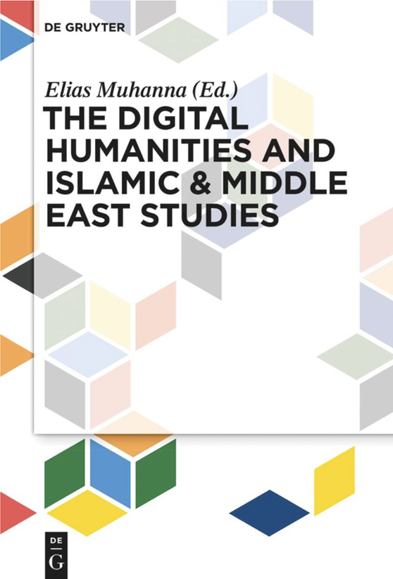

2016 · a collective starting point

The Digital Humanities and Islamic &amp; Middle East Studies

Elias Muhanna (ed.)

Berlin: De Gruyter, 2016 · doi.org/10.1515/9783110376517

Reflection on digital scholarship alongside computational case studies

Most contributions reflect on “the digital” rather than practice it.

Part 1 · State of the field

Notes:
Outline 1.C: Book-length contributions show a field taking shape. Planned time: 40 seconds.

Introduce the first volume in the supplied book sequence. Preserve the distinction between reflecting on digital scholarship and applying computational methods. Editorial change: removed the unverified “3 of 11” count because the supplied notes explicitly leave the classification undecided. The rest of the supplied critical framing is retained. Transition to digital manuscript work.

<!-- reuse 2026-11-16-dh-books-soa:2 -->

--- text bkc nofit

2016202020242026

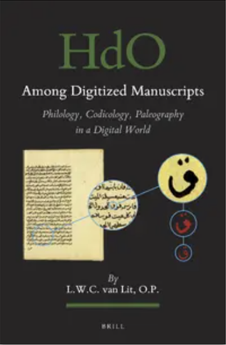

2020 · a handbook of tools

Among Digitized Manuscripts: Philology, Codicology, Paleography in a Digital World

L.W.C. van Lit

Handbook of Oriental Studies 137 · Leiden: Brill, 2020 · open access · doi.org/10.1163/9789004400351

<ul class="facts">
<li>Digitized versus physical manuscripts; twenty online repositories ranked by ten criteria</li>
<li>TEI, IIIF, catalog databases, Python and OpenCV</li>
</ul>

A methodological handbook whose historical and philological applications remain to be developed.

Part 1 · State of the field

Notes:
Four years later, Brill published Cornelis van Lit's Among Digitized Manuscripts in the Handbook of Oriental Studies. It discusses how digitized manuscripts differ from physical ones, ranks twenty online repositories by criteria such as resolution, color, and download options, and introduces TEI, IIIF, cataloging, and image processing with Python and OpenCV, ending with an autobiographical postscript. Reviewers were kind: Philip Bockholt called it a welcome contribution (MIDÉO 37, 2022). My own reading is less generous. The book explains formats and tools, but it does not pose a historical or philological question and it produces no analytical result. That is a problem for the field: it presents digital humanities as a technical service rather than a way of doing research.
[Bockholt, review of van Lit, MIDÉO 37 (2022): 215–218, journals.openedition.org/mideo/8299. Chapter list from the review: 1 manuscript, print, digital worlds; 2 digital materiality; 3 twenty repositories, an ethnography; 4 paleography; 5 digital editing standards (TEI); 6 cataloging; 7 codicology with Python and OpenCV; 8 “A Digital Orientalist”; postscript after Kračkovskij.]

<!-- reuse 2026-11-16-dh-books-soa:3 -->

In speech, acknowledge the treatment of digital materiality and explain the criterion used to assess the contribution.

--- text bkc nofit

2016202020242026

2024 · a project and its infrastructure

An Unruly Classic: Kalīla and Dimna and Its Syriac, Arabic, and Early Persian Versions

Beatrice Gründler and Isabel Toral (eds.)

Global Arabic Literary Cultures 2 · Leiden: Brill, 2024 · open access · doi.org/10.1163/9789004693579

<ul class="facts">
<li>Variation and mutability across the versions of one text</li>
<li>The digital infrastructure the project needed, including a chapter on its software</li>
</ul>

A detailed study of variation and transmission across a single textual tradition.

Part 1 · State of the field

Notes:
A more engaging example came in 2024 from the Kalīla and Dimna project in Berlin: An Unruly Classic, edited by Beatrice Gründler and Isabel Toral. The volume studies variation and mutability across the Syriac, Arabic, and early Persian versions of one text, and it engages with the digital infrastructure such a project needs — there is a chapter on the software the project used. Here the digital work serves a philological question. But it remains a case study of a single, if unruly, textual tradition; it does not tell us what the approach can do for the written tradition as a whole.
[Chapters (Crossref): Gründler and Toral, introduction; Gründler, Arabic versions as continua; Khalfallah, the chapter of the king and his dreams; Redwan, illustrations; van Ginkel, friendship; Beers, Naṣr Allāh Munšī’s preface; Toral, the panther and the fox; Stephan, poetic moments; Kozae, software use in the project; lists of manuscripts.]

<!-- reuse 2026-11-16-dh-books-soa:4 -->

Then ask orally which comparisons can extend across traditions.

--- text bkc nofit

2016202020242026

2026 · the KITAB results

The Making of the Arabic Book

<b>Vol. 1:</b> <i>How Text Reuse Built a World Tradition</i>. Sarah Bowen Savant <b>Vol. 2:</b> <i>Writerly Practices, Memory and Communities</i>. Mathew Barber, Lorenz Nigst, Aslisho Qurboniev, Gowaart Van Den Bossche, Peter Verkinderen

Edinburgh University Press, December 2026 · open access

<ul class="facts" style="font-size:28px;margin-top:22px">
<li>Text reuse across more than a billion words of Arabic, c. 700–1500 CE</li>
<li>How authors reused texts, how they described it, what it did to the tradition</li>
</ul>

<b>Shared foundation</b>OpenITI: the corpus and methods described in chapter 2 of my book, which also underlie EIS1600

Part 1 · State of the field

Notes:
And this year the field gets its first large-scale results. The KITAB project publishes The Making of the Arabic Book in two open-access volumes with Edinburgh University Press: Sarah Bowen Savant's How Text Reuse Built a World Tradition, and a second volume by Mathew Barber, Lorenz Nigst, Aslisho Qurboniev, Gowaart Van Den Bossche, and Peter Verkinderen on writerly practices, memory, and communities. They trace text reuse across more than a billion words of Arabic from roughly 700 to 1500 and ask how authors reused texts, how they themselves described the practice, and what it did to the written tradition. These books form a cluster with mine: the corpus they rest on, OpenITI, is described in the second chapter of my book, and it is also the foundation of my EIS1600 project.
[Edinburgh University Press pages (published December 2026, pre-order as of Nov. 16): edinburghuniversitypress.com/book-the-making-of-the-arabic-book-volume-1.html and …-volume-2.html. Vol. 1 cover: “Data creation and curation: Masoumeh Seydi and Sarah Bowen Savant.” Vol. 2 case studies: Mālikī scholars of North Africa, Ismaʿili communities of northwest Syria, Fatimid, Ayyubid and Mamluk historiography, the Iḫwān al-Ṣafāʾ.]

<!-- reuse 2026-11-16-dh-books-soa:5 -->
--- text bkc nofit

2016202020242026

2026 · a proposition for the field

Digital Humanities for Arabic and Islamic Studies: A Proposition for the Field

Maxim Romanov

Handbook of Oriental Studies 199 · Leiden: Brill, 2026 · doi.org/10.1163/9789004760530

<ul class="facts">
<li><b>Why:</b> the scale of the written tradition and the limits of reading it text by text</li>
<li><b>How:</b> a corpus built for research: OpenITI, mARkdown, URIs, versioned releases</li>
<li><b>What it gives:</b> term histories, textual typology, linguistic periodization</li>
</ul>

What should digital humanities in our field be, and what can it give us?

Part 1 · State of the field

Notes:
My own book, published by Brill this year in the same series as van Lit's, is an attempt to propose a coherent vision of what digital humanities can be for our field. It makes the case in three steps. Why: the written tradition is too large to be understood text by text, and we need ways to read it as a whole. How: a corpus designed for research — OpenITI, its mARkdown annotation, URIs, and versioned releases, the foundation that KITAB and EIS1600 share. And what it gives: three case studies with historical results — the history of a term (the six books), a typology of Arabic writing, and a periodization based on language and themes. This is the segue: what should digital humanities in our field be, and what can a proper implementation give us?
[Book structure: A Pitch for Digital Humanities; Digital Avatars and Metaobjects (OpenITI: corpus design, mARkdown, URIs, metadata, releases); Computational Inquiries, Case Studies 1–3 (tracing term usage; modeling textual typology; charting linguistic evolution).]

--- text cons max=40

# A field without consolidation

<ul>
<li>Articles</li>
<li>Projects</li>
<li>Resources</li>
<li>Methods</li>
<li>Occasional workshops</li>
<li><strong>No consolidation</strong></li>
</ul>
<ul class="r">
<li>The field is small: no place offers a critical mass of scholars to move this forward</li>
<li><em>Exception:</em> the Centre for Digital Humanities (CDH) at Aga Khan University–London, led by Professor Sarah Savant a close collaborator, with whom I have been working on this vision of DH since 2014</li>
</ul>

Part 1 · State of the field

Notes:
Beyond these books, digital work in our field appears as articles, projects, resources, methods, and occasional workshops, but it has not consolidated. The field is small, and no place offers a critical mass of scholars to move it forward. The exception is the Centre for Digital Humanities at Aga Khan University–London, led by Sarah Savant, a close collaborator with whom I have been working on this vision of digital humanities since 2014.

--- section light partdiv
<!-- divider · Part 2 -->

Part

2

# My contributions

Resources, methods, and historical results

Notes:
Part 2: My contributions.

--- text max=40
# The Vision

The work I’ll show you starts from one proposition:

> digital Arabic philology allows us to study the Arabic written tradition as a whole through a unified, machine-readable corpus. We can ask how scholarly communities changed, how texts drew on one another, how their typology developed, and how Arabic itself evolved. And we can move from a single passage to patterns across centuries and regions, then return to the passages and their contexts to see what those patterns mean. And never lose the sight of the big picture.

Part 2 · My contributions

Notes:
The work I’ll show you starts from one proposition: digital Arabic philology allows us to study the Arabic written tradition as a whole through a unified, machine-readable corpus. We can ask how scholarly communities changed, how texts drew on one another, how their typology developed, and how Arabic itself evolved. And we can move from a single passage to patterns across centuries and regions, then return to the passages and their contexts to see what those patterns mean. And never lose the sight of the big picture.

--- split w-35-65 max=44
<!-- reuse 2026-09-28-Cairo:62 -->

|||

In short, this book asks:

«What does it mean for our field when the entire library becomes a vademecum — something that, quite literally, “goes with me” everywhere?»

<h3 style="font-size:0.70em;font-style:normal;border-top:2px solid var(--red);padding-top:.35em">Chapter 1</h3>
Why we should even bother—a question that remains at the heart of every discussion about the digital.

<h3 style="font-size:0.70em;font-style:normal;border-top:2px solid var(--red);padding-top:.35em">Chapter 2</h3>
How we might go about harnessing the new digital opportunities within the field.

<h3 style="font-size:0.70em;font-style:normal;border-top:2px solid var(--red);padding-top:.35em">Chapter 3</h3>
What we can expect to accomplish: 1) trace term usage 2) model textual typology 3) chart linguistic evolution

Altogether, the book proposes a vision of digital humanities relevant to the field of <strong>Arabic and Islamic studies</strong>. It argues that this venture is not about cheating, but about keeping up with the rest of the world and ensuring that the future of the field remains in our own hands.

Part 2 · My contributions

--- text domains max=44
<!-- src: 2026-09-22-fub-keynote:17 -->

# The Proposition: <em>Four Domains</em>

IDigital AvatarsMachine-readable editions of manuscripts and printed books

IIMetaobjectsCorpora, databases, and linked open data at scale

IIIComputational MethodsStatistics, stylometry, and NLP adapted for Arabic

IVNetworksKnowledge networks: text, person, place, and time connected

The domains connect the construction of evidence with historical interpretation.

Part 2 · My contributions

Notes:
Outline 2.A: The book’s proposition: four connected domains. Planned time: 75 seconds.

Explain the four domains: digital representations of material objects; metaobjects such as corpora and databases; computational methods; and networks of knowledge. Interpretation informs work throughout. These are the book’s methodological domains. They are distinct from VISIÓN’s four research axes: texts, textual types, transmission, and language.

--- section light
<!-- reuse 2026-09-28-Cairo:5 -->

The main resource

# A Proxy to the Arabic Written Tradition

OpenITI as a chronological and geographical representation

Part 2 · My contributions

--- text max=44
<!-- reuse 2026-09-28-Cairo:6 -->
# OpenITI <a href="https://github.com/OpenITI">github.com/OpenITI</a>

<b>8,700+</b>titles

<b>3,300+</b>authors

<b>2.4 billion</b>words, all versions

Nigst, Lorenz, Maxim Romanov, Sarah Bowen Savant, Masoumeh Seydi, and Peter Verkinderen. <em>OpenITI: A Machine-Readable Corpus of Islamicate Texts, Primary Version.</em> Version 2025.1.9. Zenodo, 2026. <a href="https://doi.org/10.5281/zenodo.18613982">doi.org/10.5281/zenodo.18613982</a>

Part 2 · My contributions

--- text max=44
<!-- reuse 2026-09-28-Cairo:7 -->
# The book’s analytical subcorpus

Selected from **OpenITI 2023.1.8** for the analyses through **1400 AH / 1980 CE**.

- **2,783** authors
- **7,058** unique texts
- **868.81 million** tokens after cleaning

Figures describe the selected analytical subcorpus. Most editorial material was removed before analysis.

Part 2 · My contributions

Notes:
The comparisons with “the set above” are removed: their baseline is not shown.

--- figure
<!-- reuse 2026-09-28-Cairo:8 -->
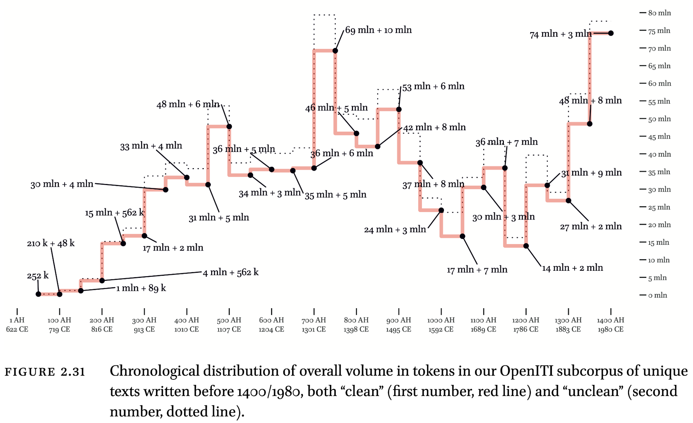

Part 2 · My contributions

--- figure
<!-- reuse 2026-09-28-Cairo:9 -->
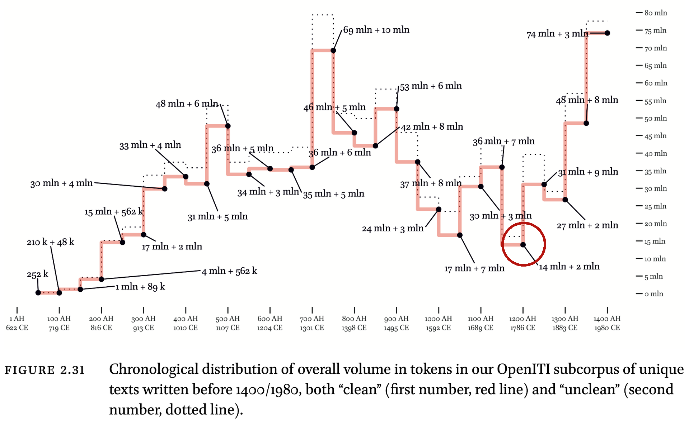

Part 2 · My contributions

--- text max=44
<!-- reuse 2026-09-28-Cairo:4 -->
# The same framing at every scale

١A termis understood through the corpus: when does it appear across time and space? who uses it? and who doesn’t?

٢A bookis understood through other books: what other books does it build on? how does it fit among the rest?

٣A traditionis understood through the geographical and chronological layers of books: how does its language change? how do its topics shift?

Part 2 · My contributions

Notes:

--- section light
<!-- reuse 2026-09-28-Cairo:10 -->

Case 1

# A term in time

When did <em>al-kutub al-sittaŧ</em> come to be?

Part 2 · My contributions

--- text steps max=44
<!-- reuse 2026-09-28-Cairo:11 -->
# Case 1: <em>al-kutub al-sittaŧ</em> (الكتب الستة)

In “The Devil’s Delusions” (<em>Talbīs Iblīs</em>), Ibn al-Jawzī (d. 597/1201) uses lots of <i>ḥadīṯ</i>s:

 

<em><strong>- &nbsp; No isnāds for</strong>: Muslim, al-Buḫārī, and Abū Dāwūd</em>

 

<em><strong>- &nbsp; Full isnāds for</strong>: al-Tirmiḏī, Ibn Mājah, and al-Nasāʾī</em>

 
 

No notion of al-kutub al-sittaŧ in the end of the 6th/12th century in Baġdād.

Part 2 · My contributions

--- figure
<!-- reuse 2026-09-28-Cairo:12 -->
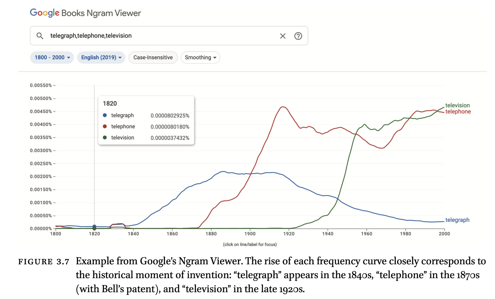

Part 2 · My contributions

--- figure
<!-- reuse 2026-09-28-Cairo:13 -->
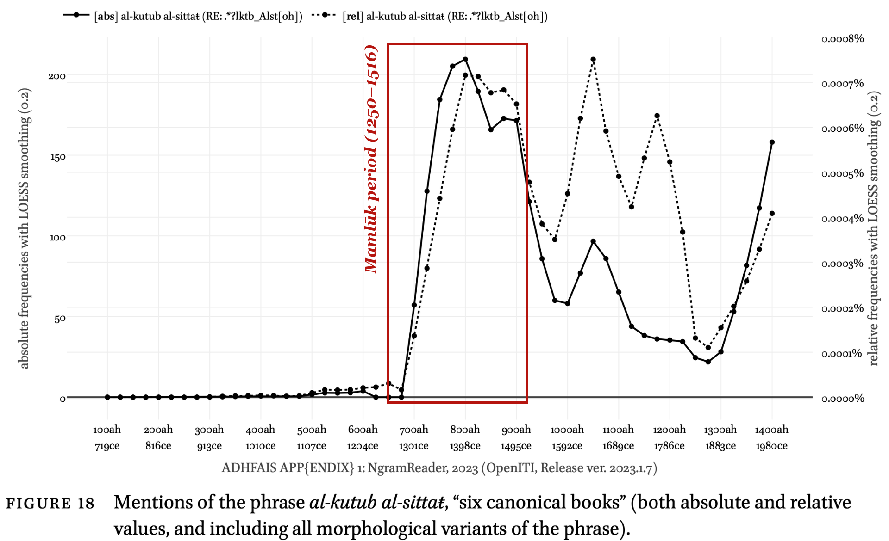

Part 2 · My contributions

--- figure lowfig
<!-- reuse 2026-09-28-Cairo:14 -->
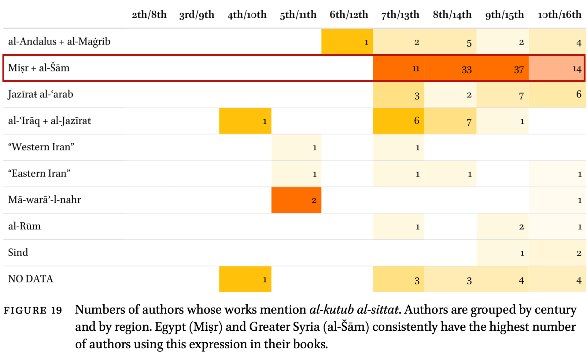

Part 2 · My contributions

--- section light
<!-- reuse 2026-09-28-Cairo:15 -->

Case 2

# A book among books

By modeling major textual types, we can trace their presence in time, identify types of unknown books, and understand the structural composition of complex books

Part 2 · My contributions

--- text max=44
<!-- reuse 2026-09-28-Cairo:26 -->
# Case 2. Modeling Textual Typology

<ol class="small" style="max-width:37em">
<li><code>[B]</code> Biographical type (<em>tarājim</em>): mostly collections of biographies</li>
<li><code>[E]</code> Exegetical type: interpretations of the Qurʾān (<em>tafsīr</em>)</li>
<li><code>[G]</code> Graeco-Arabic (“Greek-esque”) type (<em>yūnāniyyāt</em>): translations from Greek and works on the development of Greek philosophy in Arabic (<em>falsafat</em>, predominantly Aristotelian)</li>
<li><code>[H]</code> Historical type (<em>tawārīḫ</em>): mainly chronicles</li>
<li><code>[F]</code> Legal type (<em>fiqh</em>): a broad variety of legal texts</li>
<li><code>[L]</code> Linguistic type: a broad variety of grammatical, rhetorical, and lexicographical texts (<em>balāġat</em>, <em>naḥw</em>, <em>maʿājim luġawiyyat</em>)</li>
<li><code>[M]</code> Medical type (<em>ṭibb</em>): mainly texts on Galenic medicine</li>
<li><code>[P]</code> Poetic type (<em>šiʿr</em>): mainly collections of poetry (<em>dīwān</em>s)</li>
<li><code>[K]</code> “Scholastic-theological” type: works of <em>kalām</em></li>
<li><code>[Ḥ]</code> Tradition-based type: collections of <em>ḥadīṯ</em></li>
</ol>

Part 2 · My contributions

--- text trends max=40
<!-- adapted from book pp. 216–217 (Case Study 2, Bird's-Eye View: Trends over 14 Centuries); replaces 2026-09-28-Cairo:27 -->

# Textual types over 14 centuries

<ul class="dash small">
<li>The <code>[F]</code> <strong>legal type</strong> (represented by approximately 1,600 titles)
<ul class="sub"><li>steady growth in prevalence over time, peaking around 1000–1200/1592–1786. It is the dominant type in the corpus overall.</li></ul></li>
<li>The <code>[Ḥ]</code> <strong>Tradition-based type</strong> (approximately 1,250 titles)
<ul class="sub"><li>pronounced early dominance, peaking around 400/1010, and then declines sharply.</li></ul></li>
<li>The <code>[B]</code> <strong>biographical type</strong> (approximately 1,050 titles)
<ul class="sub"><li>grows steadily until the end of the Mamlūk period, after which it declines.</li></ul></li>
<li>The <code>[L]</code> <strong>linguistic type</strong> (approximately 790 titles)
<ul class="sub"><li>somewhat more prevalent in the early period but generally remains steady across the centuries.</li></ul></li>
<li>The <code>[E]</code> <strong>exegetical type</strong> (approximately 750 titles)
<ul class="sub"><li>grows gradually, its numbers remaining within a fairly consistent range over time.</li></ul></li>
</ul>

Part 2 · My contributions

Notes:
Each type has a distinct trajectory. The counts are approximate: a text is assigned to a type at a 51% match threshold, numbers are rounded, and the periods before 100/719 and after 1400/1980 are excluded. Legal writing grows steadily and dominates overall; tradition-based writing dominates early and becomes marginal after 800/1398; biographical writing grows until the end of the Mamlūk period; linguistic writing stays fairly steady; and exegesis surges in the Mamlūk period.
Source: Romanov, Digital Humanities for Arabic and Islamic Studies (2026), pp. 216–217. The tafsīr validation table (old slide) is in the earlier draft and in Cairo:27.

--- text max=44
# A consistent profile and a varied composition

[Ibn al-Abbār (d. 658/1260), *al-Takmilaŧ li-l-Ṣilaŧ*](https://maximromanov.github.io/classifier/#b=0658IbnAbbar.TakmilaLiSila&t=text)

— a consistent biographical profile

[Ibn al-Jawzī (d. 597/1201), *Talbīs Iblīs*](https://maximromanov.github.io/classifier/#b=0597IbnJawzi.TalbisIblis&t=text)

— different chapters draw on different textual types

Part 2 · My contributions

Notes:
Outline 2.E: Case study 2: books and their internal composition. Planned time: 110 seconds.

DEMONSTRATION: begin with al-Takmila to establish a readily interpretable reference case. Then open Talbīs Iblīs and show how changing profiles relate to chapters and argument. Keep both pages prepared. Time includes transitions. The next two slides show both profiles as static figures.

--- text
<!-- reuse 2026-erc-interview:4 -->
# A consistently biographical text

Ibn al-Abbār (d. 658/1260), <i>al-Takmilaŧ li-l-Ṣilaŧ</i> · rolling typological assessment

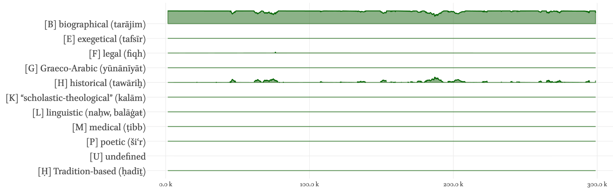

biographical profile, start to end

Each trace: the model’s probability for one textual type in a rolling window of 3,000 words, moving in steps of 200 (0 to 1). Horizontal axis: position in the text in thousands of words; this work runs to about 300,000 words.

A biographical profile persists throughout the work.<small>What happens when an author combines different kinds of material within one book?</small>

Part 2 · My contributions

Notes:
My proof-of-concept model already demonstrates a useful distinction. Here is Ibn al-Abbār’s biographical collection. Notice the continuous biographical band: the profile stays strong passage by passage. What happens when an author combines different kinds of material within one book?

--- text
<!-- reuse 2026-erc-interview:5 -->
# Different textual types within one argument

Ibn al-Jawzī (d. 597/1201), <i>Talbīs Iblīs</i>Whole-work assessment: biographical

chapters

1–4

5

6–8

9

10

11–13

<b>Chapters 1–4:</b> tradition-based reports (<i>ḥadīṯ</i>) establish the necessity of the work.

<b>Chapter 5:</b> scholastic-theological, historical, and biographical material on different beliefs and communities.

<b>Chapters 6–8:</b> legal discourse.

<b>Chapter 10:</b> biographical anecdotes in the critique of Sufism.

Textual profiles help locate the materials an author combines to construct an argument.

The chart detects changes in textual profile; close reading explains what those materials do in the argument. Vertical lines: chapter boundaries. Horizontal axis: thousands of words, about 130,000 in all; not to scale with the previous chart.

Part 2 · My contributions

Notes:
Ibn al-Jawzī’s Talbīs Iblīs offers that contrast. A whole-book assessment classifies it as biographical, but the passage-level view reveals a complex composition. Reading from left to right, the opening chapters draw on hadith reports. Discussions of beliefs and communities combine theological, historical, and biographical material. Religious practice brings legal discourse, while the critique of Sufism relies on biographical anecdotes. The model locates these shifts; close reading explains how the author uses different materials to construct his social critique.

Chapter explanations in reading order. The rolling window size determines the resolution at which a mixture is observed; reading the passages distinguishes interweaving from shifts within a window.

--- text max=44
<!-- reuse 2026-09-28-Cairo:31 -->
# Value for manuscripts:

<ol class="indent">
<li>When HTR starts working, we will need a mechanism to assess HTR-ed texts automatically: we can potentially identify type, author, exact text</li>
 
<li>Particularly valuable for <em>majmūʿāt</em> — the most numerous kind of manuscripts, the most difficult to read and analyze</li>
</ol>

Part 2 · My contributions

--- section light
<!-- reuse 2026-09-28-Cairo:32 -->

Case 3

# A Tradition

language change and topic shifts  through chronological layers  of books

Part 2 · My contributions

--- split w-60-40 max=44
<!-- reuse 2026-09-28-Cairo:33 -->
# Case 3. Periodization

<ul class="plain" style="color:var(--muted)">
<li>Preclassical &nbsp; c. 622–750</li>
<li>Classical &nbsp; 750–1258</li>
<li>Postclassical &nbsp; 1258–1798</li>
<li>Modern &nbsp; 1798–</li>
</ul>

<b>Preclassical</b>600–750

<b>Classical</b>750–1258

<b>Postclassical</b>1258–1798

<b>Modern</b>1798–

Where do these boundaries come from? What if we ask the corpus?

|||

<em>Geschichte der arabischen Litteratur</em>, 5 vols. (1896–1943)

<em>Cambridge History of Arabic Literature</em>, 6 vols. (1983–2006)

<em>Encyclopedia of Arabic Language and Linguistics</em> (Brill)

Part 2 · My contributions

--- section light
<!-- reuse 2026-09-28-Cairo:34 -->

Two witnesses

# First witness: Corpus

Part 2 · My contributions

--- figure
<!-- reuse 2026-09-28-Cairo:35 -->

Part 2 · My contributions

--- text max=44
<!-- reuse 2026-09-28-Cairo:36 -->
# Two lenses on change

<strong>Keywords</strong> (TF–IDF): <em class="muted">what texts are about</em> 
<strong>Style</strong> (MFV): <em class="muted">how texts are written</em>

<ul>
<li><strong>12 distance measures × 2 clustering methods</strong></li>
<li><strong>3,000 random samples (MFV)</strong></li>
<li><strong>72,000 stylometric trees → 48 consensus trees</strong></li>
<li><strong>48 separate keyword tests</strong></li>
</ul>

Do not trust a tree. Ask what survives across trees.

<b>Content</b><em>keywords / TF–IDF</em>

<b>Style</b><em>most frequent vocabulary</em>

Part 2 · My contributions

Notes:
Stylometry: 3,000 random sampling runs × 12 distance measures × 2 clustering methods = 72,000 trees, summarized in 48 consensus trees. Keywords: 48 separate keyword tests.

--- split w-25-75 vcenter tight max=44
<!-- reuse 2026-09-28-Cairo:37 -->
# Style

stylometry

<ul class="small" style="font-style:italic">
<li>distributions of frequencies of most frequent words (function words) can help distinguish:</li>
</ul>
<ul class="small" style="font-style:italic;list-style:disc">
<li><strong class="accent">authors</strong></li>
<li>periods</li>
</ul>

|||

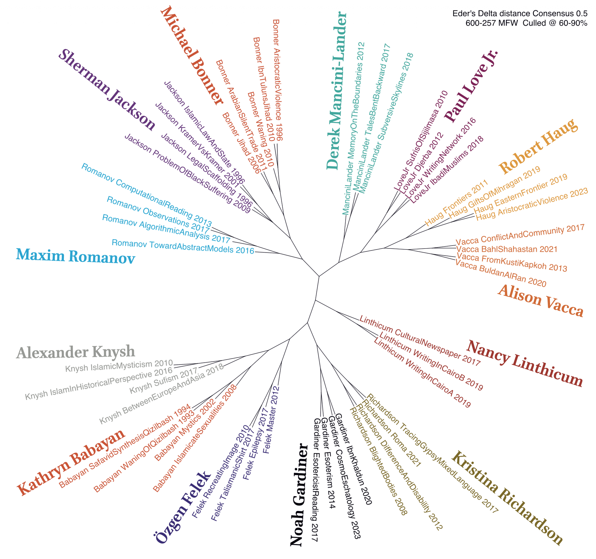

Part 2 · My contributions

Notes:

--- split w-25-75 vcenter tight max=44
<!-- reuse 2026-09-28-Cairo:38 -->
# Style

stylometry

<ul class="small" style="font-style:italic">
<li>distributions of frequencies of most frequent words (function words) can help distinguish:</li>
</ul>
<ul class="small" style="font-style:italic;list-style:disc">
<li>authors</li>
<li><strong class="accent">periods</strong></li>
</ul>

<strong>Jurjī Zaydān’s writings</strong> (1) 1891–1902  (2) 1903–1905  (3) 1906–1914

|||

Part 2 · My contributions

Notes:

--- figure caption="A single dendrogram of 50-lunar-year samples of the corpus, colored by macroperiod. Hijrī dates!"
<!-- reuse 2026-09-28-Cairo:39 -->

Part 2 · My contributions

--- figure caption="72,000 dendrograms: hundreds of parameter combinations over 3,000 random samples."
<!-- reuse 2026-09-28-Cairo:40 -->
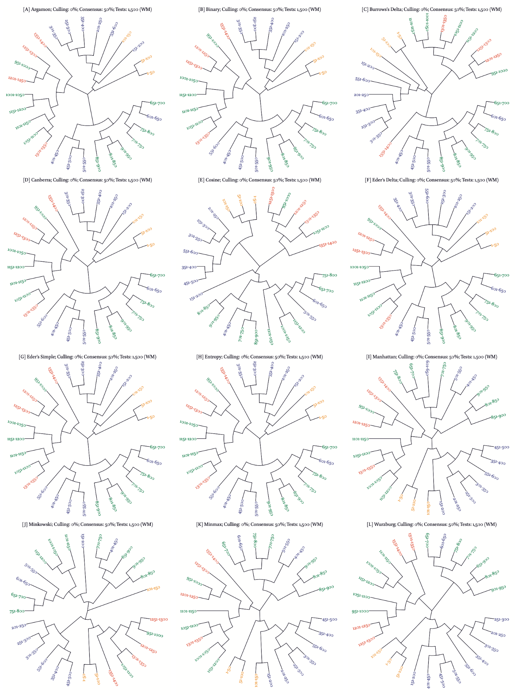
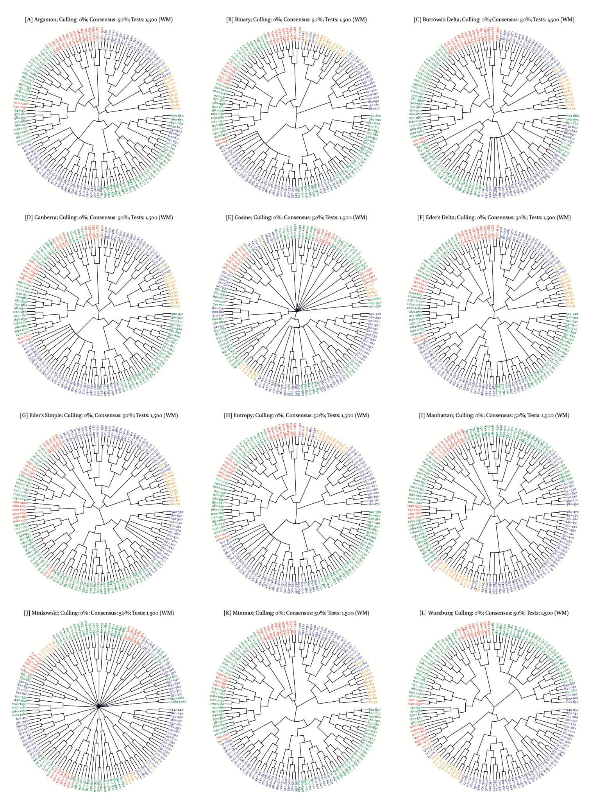

Part 2 · My contributions

--- figure caption="Summary stripe diagrams: what survives across the trees."
<!-- reuse 2026-09-28-Cairo:41 -->
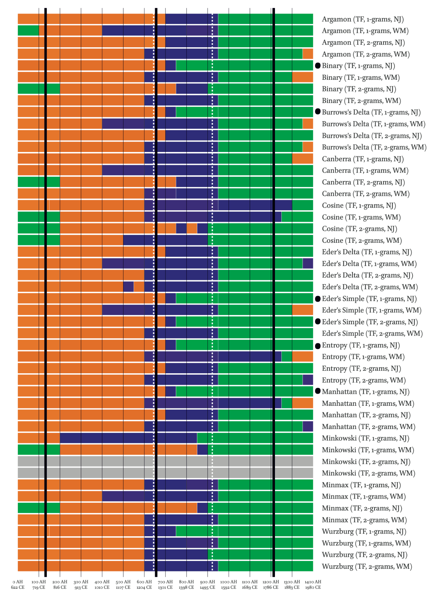

Part 2 · My contributions

--- text mp max=40
<!-- combines 2026-09-28-Cairo:42 and 2026-09-28-Cairo:43 -->

# Major periods

<h2>Three macroperiods</h2>
<ul>
<li>Early (622–1200)</li>
<li>Middle (1200–1540)</li>
<li>Late (1540–1980)</li>
</ul>

<strong>Results of the majority of 72,000 dendrograms:</strong>

3,000 stylometric samples (1,500 discrete; 1,500 overlapping) 12 distance metrics, 2 major clustering algorithms; 48 tf-idf keyword tests.

<h2>The middle macroperiod (c. 1200–1540)</h2>
<ul>
<li><em>Thematic profiles</em> tend to isolate it as a distinct period</li>
<li><em>Stylometric profiles</em> tend to attach it to the early macroperiod</li>
<li>The language evolves slower than the written tradition: new distinct themes, but older language</li>
</ul>

Two clocks: themes shift faster than language.

Part 2 · My contributions

--- section light
<!-- reuse 2026-09-28-Cairo:45 -->

Two witnesses

# Second witness:  Bio-Bibliographical Collection

Part 2 · My contributions

--- text max=44
<!-- reuse 2026-09-28-Cairo:46 -->
# Second witness: 8,800 authors

Ismāʿīl Bāšā al-Baġdādī (d. 1338/1919)

<em>Hadiyyaŧ al-ʿārifīn</em> <em>c. 8,800 authors; 40,000+ titles</em> A bio-bibliographical model of the tradition

<strong>Bibliographical evidence for a separate comparison</strong>

<b>8,800</b>authors

<b>40,000+</b>titles

Part 2 · My contributions

Notes:

--- text max=44
<!-- reuse 2026-09-28-Cairo:47 -->
# c. 600–1200: an Iraqi-Iranian world

<b style="font-size:36px">&gt; 80% Iraq + Iran</b>

Part 2 · My contributions

--- text max=44
<!-- reuse 2026-09-28-Cairo:48 -->
# c. 1200–1540: a Syrian-Egyptian world
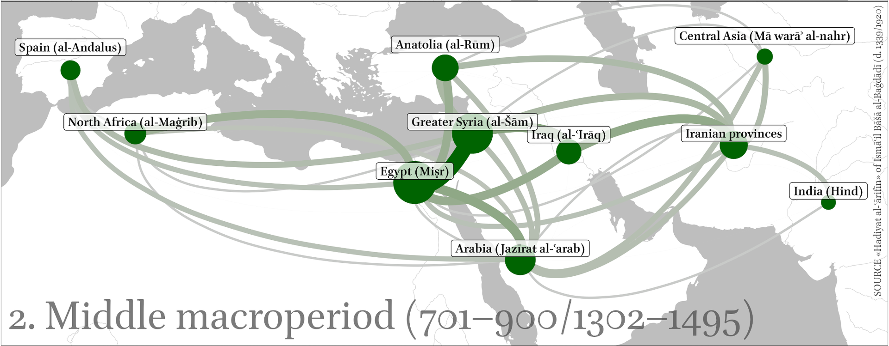

<b style="font-size:36px">&gt; 55% Egypt + Syria</b>

Part 2 · My contributions

--- text max=44
<!-- reuse 2026-09-28-Cairo:49 -->
# c. 1540–1900: a new polycentric geography

<b style="font-size:36px">≈ 30%  Anatolia</b>

Part 2 · My contributions

--- text max=44
<!-- reuse 2026-09-28-Cairo:50 -->
# Two transitions: <strong>1200–1300</strong> and 1500–1600

Part 2 · My contributions

--- text max=44
<!-- reuse 2026-09-28-Cairo:51 -->
# Two transitions: 1200–1300 and <strong>1500–1600</strong>
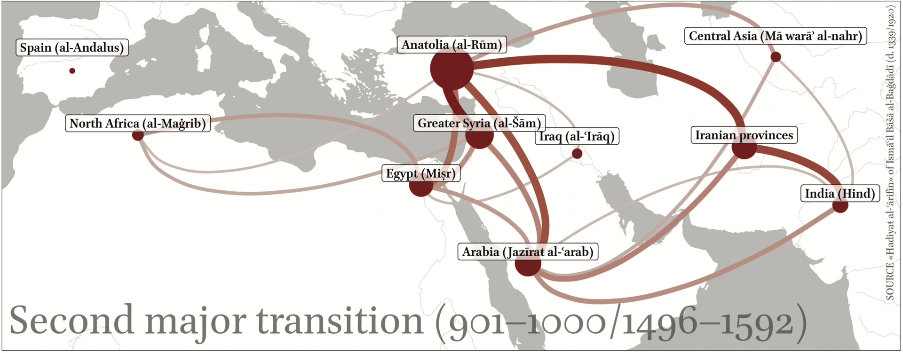

Part 2 · My contributions

--- text max=44
<!-- reuse 2026-09-28-Cairo:52 -->
# Two sources, converging patterns

<strong>CORPUS of TEXTS</strong> lexical/thematic and stylometric change

<strong>REGISTER of AUTHORS</strong> cultural geography over time

Textual change and bibliographical geography point to a broad historical reconfiguration.

Part 2 · My contributions

Notes:
Acknowledge that survival and selection can affect both sources.

--- text max=44
<!-- reuse 2026-09-28-Cairo:53 -->
# Three long cultural regimes (macroperiods)

<!-- period blocks moved here from 2026-09-28-Cairo:44 -->

Earlyc. 622–1200

Middlec. 1200–1540

Latec. 1540–1980

<ol class="indent" style="margin-left:7.5em">
<li>The early Iraqi-Iranian &nbsp;·&nbsp; <em>c. 622–1200</em></li>
<li>The middle Syrian-Egyptian &nbsp;·&nbsp; <em>c. 1200–1540</em></li>
<li>The late Turco-Indian &nbsp;·&nbsp; <em>c. 1540–1980</em></li>
</ol>

(with discernable sub-periods inside each)

Part 2 · My contributions

--- text nofit
# Quantitative evidence and interpretive analysis

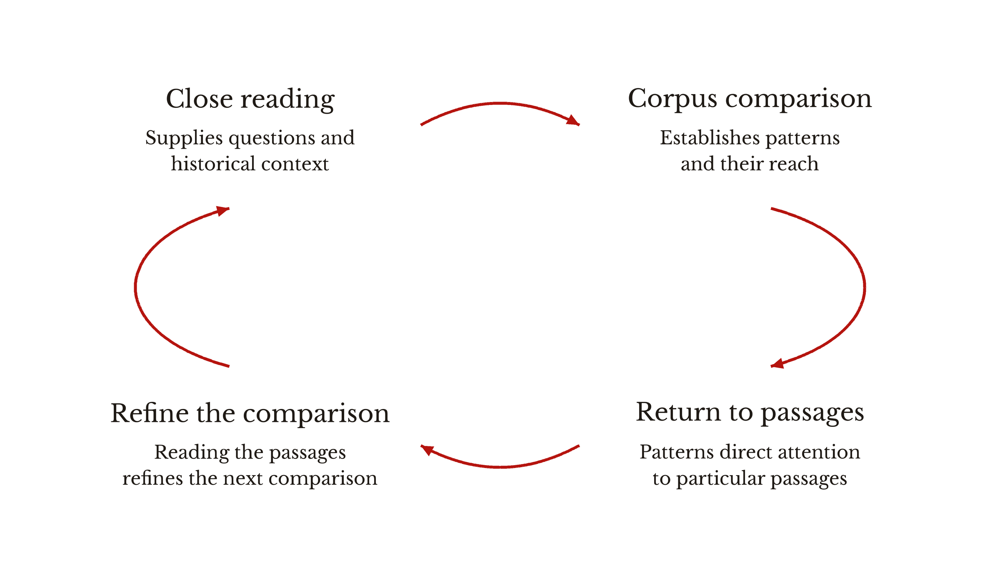

Part 2 · My contributions

Notes:
Outline 2.G: The heuristic loop between close and distant reading. Planned time: 50 seconds.

Interpretation is involved throughout, from evidence construction to explanation. Avoid a rigid division between quantitative discovery and qualitative interpretation. This connects all three case studies and prepares the shift to biographical evidence.

[ChAstra, C15] Citation practice in Talbīs Iblīs supplies the question. The corpus provides a distribution of the Six Books designation. Reading the hits determines what that distribution means. The same movement between scales guides the biographical studies.

--- section light

EIS1600 · Ongoing research

# Evolution of Islamic Societies (c. 600–1600)

Algorithmic Analysis into Social History

Part 2 · My contributions

Notes:
From the written tradition to its people: the EIS1600 project, Evolution of Islamic Societies, c. 600–1600, which applies algorithmic analysis to social history through biographical collections.

--- text max=44
# EIS1600: biographies linked across collections

<b>604,000</b>biographical records

<b>≈140,000</b>identified individuals

<b>285</b>biographical collections

- Approximately **104,000 individuals with explicit dates, geographies, and social profiles** (based on *nisbaŧ*s)
- Compare recorded lives across collections, regions, and periods

EIS1600 team · current project figures, November 2026

Part 2 · My contributions

Notes:
Outline 2.H: EIS1600: from biographical evidence to historical research. Planned time: 75 seconds.

Distinguish records from linked individuals. Around 340,000 records with chronological or geographical evidence form the usable merged subset; do not suggest all 604,000 records independently resolve to 140,000 people. Approximately 80,000 dated individuals concern the first millennium of Islamic history in the agreed outline. Credit the project team. The comparison with PUA is one of scope, not scholarly quality.

--- text max=44
<!-- PLACEHOLDER: replaces ChAstra's A2 ("How al-Ḏahabī rewrote Andalusian biographies"); Maxim will pick slides from the library -->
# Al-Ḏahabī and his Andalusian sources

[Placeholder: a couple of slides from the presentation library to follow]

Part 2 · My contributions

Notes:
Placeholder. Candidate material in the library: the Vienna 2025 deck (2025-12-09-vienna, the Golden Sample block) and the NRLXU paired biography prepared for the first CSIC draft.

--- text max=44
# 3 volumes establish the research foundation

**Vol. 1. *Methodological Companion*:** 
— Extraction, annotation, reconciliation, and analysis

**Vol. 2. *Historical Atlas of Social Groups*:** 
— Tribal, religious, professional, and other social groups across time and space

**Vol. 3. *Analytical Reference on Biographical Collections*:** 
— Their social, geographical and chronological coverage in relationship with other collections

Target: complete drafts by the end of EIS1600 in mid-2027.

Part 2 · My contributions

Notes:
Outline 2.H: EIS1600: from biographical evidence to historical research. Planned time: 70 seconds.

This is a drafting target, not a promise of publication by the project’s end. The atlas asks, for example, how the geography of the Mālikī school differs from the Šāfiʿī. The analytical reference compares collections such as Ibn al-Faraḍī’s Tārīḫ ʿulamāʾ al-Andalus and al-Ḫaṭīb al-Baġdādī’s Tārīḫ Baġdād. The two interpretive syntheses follow as a continuing agenda at the Escuela and are developed in Part 3. Source: Maxim’s update of November 16, 2026.

--- text max=44
# A related study of monetary equivalents

**68,000 monetary equivalents in historical sources**

- Who paid whom, for what, and how much?
- Where and when did the transaction occur?
- Approximately 85% can be situated in time and space.

EIS1600 doctoral research · Hamid Reza Hakimi

Part 2 · My contributions

Notes:
Outline 2.H: EIS1600: from biographical evidence to historical research. Planned time: 40 seconds.

Keep the contribution distinct from the five-volume program. Credit the dissertation researcher and team. The quantity and locatability figure come from the agreed detailed outline. This example demonstrates that the methods support a researcher’s independent historical question.

--- text max=44
# A foundation for sustained research

**Social history · Texts · Language**

- Case studies demonstrating the range of historical, textual, and linguistic questions that computational methods can address.
- Biographical data connecting individuals, places, periods, and sources for the study of social history and historiography.
- The first three EIS1600 volumes organizing the methods and evidence on which further interpretation and synthesis can build.

This foundation supports a sustained research agenda—from social history, through texts and their typology, to language and its evolution.

Part 2 · My contributions

Notes:
Outline 2.I: What these contributions establish together. Planned time: 40 seconds.

Close Part 2 with the shared achievement: case studies across historical, textual, and linguistic questions; biographical data linking individuals, places, periods, and sources; and the first three EIS1600 volumes, which organize methods and evidence for further interpretation and synthesis. Together they support a sustained agenda from social history, through texts, to language.

--- section light partdiv p3
<!-- P3.00 · Divider · 10 seconds -->

Part

3

# Research at the Escuela

A sustained program in digital Arabic philology

Notes:
[10 seconds] The case studies, data, and volumes establish a foundation. I now turn to how I would develop this work at the Escuela de Estudios Árabes, both through my own research and through my contribution to its scholarly community.

--- text p3 max=40
<!-- P3.01 · Institutional overview · 55 seconds -->
# My contribution to the Escuela

- **Research:** social history, historiography, textual typology, and evolution of language.
- **Instruction and training:** apprenticeship, workshops, and summer schools.
- **Methodological consultations:** computational approaches to colleagues’ questions and sources.
- **Collaborations:** joint research within the Escuela and through international partnerships.
- **Digital Arabic Philology Lab:** new instruments for historical and philological inquiry. (Examples: [NgramReader](https://maximromanov.github.io/ngramreader/) *&* [Book Classifier](https://maximromanov.github.io/classifier/))

Part 3 · Research at the Escuela

Notes:
[55 seconds] I see five connected directions for my contribution. Research provides the substantive questions. Instruction helps researchers develop the knowledge and judgment to pursue their own projects. Consultations address particular methodological problems. Collaborations develop shared investigations. The laboratory provides a sustained setting for developing the instruments this research requires.

I will first explain how these activities would work at the Escuela, then develop the research agenda in more detail, moving from social history and historiography through texts to language. Finally, I will explain the initial priorities and how additional funding could expand the program.

--- text p3 max=44
# Why the Escuela de Estudios Árabes

- **A scholarly connection:** María Luisa Ávila, Luis Molina, and the *Prosopografía de los ulemas de al-Andalus* helped shape my dissertation methodology.
- **A community of colleagues:** sustained exchange with specialists in Arabic philology, history, and the western Islamic world.
- **Granada as an international meeting place:** a European city with a central place in the history of al-Andalus.

A setting for developing the Digital Arabic Philology Laboratory through research, training, and collaboration.

Part 3 · Research at the Escuela

Notes:
PUA, together with Onomasticon Arabicum and the Netherlands Ulama Project, helped me develop my own approach. Working at the Escuela would mean carrying this line of inquiry forward alongside colleagues who know the sources and their historical contexts.

The concentration of relevant expertise matters for methodological development as well as interpretation. Granada’s history and international recognition can also help make it a meeting place for scholars working on the Arabic written tradition. Emphasize the personal and intellectual connection to the institution. [40–50 seconds]

--- text p3 max=44
<!-- P3.02 · Instruction · 50 seconds -->
# Instruction through active research

1. **Introduce the methodology** and explain what the analysis can establish.
2. **Work through the same texts together**, using the same data and settings.
3. **Design an investigation for participants’ own texts** and research questions.

Develop the judgment to choose, apply, and interpret an analysis independently.

At the Escuela in 2024 · Computational analysis of Andalusian prosopography

Part 3 · Research at the Escuela

Notes:
[50 seconds] My preferred model is instruction through active research. Participants bring a question and a body of sources. We work through the assumptions of the method, preparation of the evidence, analysis, and checking the results against the texts. Each participant develops an identifiable scholarly contribution and the ability to continue independently.

This can take the form of individual mentoring, focused workshops, or summer schools with follow-up. The computational Andalusian prosopography activity at the Escuela in 2024 provides a direct precedent. Other experience includes Tokyo, Hamburg, Bern, and Madrid; mention only one further example if useful. The scale and frequency of future activities would be developed with colleagues and available resources.

Transition: instruction develops a sustained skill set; consultations can also help with a specific problem within an existing project.

A shared exercise gives participants a common result to understand and discuss. This helps them focus on the unfamiliar method before working through a new interpretation as well. Their own sources enter at the research-design stage. Language models make coding and command-line work easier to introduce, while beginners still require guided practice. For stochastic analyses, explain the seed or expected variability.

--- text p3 max=44
<!-- P3.03 · Consultations · 45 seconds -->
# Methodological consultations

- Assess what computational analysis can contribute to a question.
- Identify suitable sources, data preparation, and methods.
- Work through exploratory results and their interpretation.

A practical point of contact for colleagues developing digital approaches.

Part 3 · Research at the Escuela

Notes:
[45 seconds] A colleague may have a source collection and a historical question but be unsure whether computational analysis would help, what preparation it requires, or how to interpret an initial result. A focused consultation can clarify the possibilities and limitations and identify a manageable next step.

The outcome might be a comparison to try, a plan for preparing the sources, or a clearer assessment of what the available evidence can support. Some consultations may develop into joint work; others will help colleagues move forward independently. This is distinct from both formal instruction and an ongoing collaborative project.

--- text p3 max=44
<!-- P3.04 · Collaborations · 50 seconds -->
# Collaboration within and beyond the Escuela

- Develop joint questions from colleagues’ source expertise and comparative methods.
- Connect al-Andalus and the Maghrib with the wider Arabic written tradition.
- Build shared studies, supervision, and proposals through existing research networks.

An initial conversation with José Bellver concerns computational approaches to the concepts and relationships in Ibn ʿArabī’s thought.

OpenITI · KITAB · Spanish and German collaborations · International research and training exchanges

Part 3 · Research at the Escuela

Notes:
[50 seconds] Collaboration is reciprocal. Colleagues’ knowledge of sources and historical contexts helps define and test the analysis; corpus comparison can extend the geographical or chronological reach of their questions. The Escuela’s work on al-Andalus and the Maghrib offers a particularly productive setting for comparisons across the Arabic tradition.

Existing relationships provide a basis for joint projects and exchanges. Depending on the example, mention Maribel Fierro or Mayte Penelas; OpenITI and KITAB collaborators such as Sarah Bowen Savant, Matthew Thomas Miller, and David Smith; or German philological and historical collaborations. These are existing connections, not commitments by those colleagues to a new project. Emphasize what a collaboration would investigate rather than reciting a list of names.

Begin with a few concepts in selected works. José’s expertise would shape the concepts, examples, and interpretation. Develop and evaluate a method through those examples. This is an exploratory collaboration already discussed, with its scope to be worked out together.

--- text p3 max=44
<!-- P3.05 · Laboratory · 50 seconds -->
# A Digital Arabic Philology Lab

- Develop instruments for language, textual composition, and biographical evidence.
- Connect corpus analysis with passages, sources, and historical context.
- Make methods and resources from individual studies usable in further research.
- Research instruments can bring several analyses of a text together for rapid hypothesis testing and passage-level review.

Research questions guide the development of new instruments.

Part 3 · Research at the Escuela

Notes:
[50 seconds] NgramReader and Book Classifier illustrate the principle: a research question leads to a method, and the method becomes an instrument that others can use to investigate further questions. The laboratory would sustain this development across language, texts, and biographical evidence.

Its work includes documented corpora, datasets, methods, and applications. Preserving the evidence and methodological documentation matters beyond the lifespan of any particular interface. The laboratory is a proposed way of organizing this activity at the Escuela; its institutional form would be developed with colleagues. It can begin through existing research and instruments and grow through collaborative projects.

Transition: these are the ways I would contribute. What research would give this program its substance?

Longer-term institutional possibility raised by José: a future research-software post with CSIC in the Escala de Técnicos Especializados de los Organismos Públicos de Investigación. The initial research uses existing data and tools.

--- text p3 max=44
<!-- P3.06 · Research overview · 40 seconds -->
# Three connected research directions

<b>[1] Social history and historiography</b> Social transformation and its representation in biographical collections and chronicles.

<b>[2] Texts and the written tradition</b> Typology (“genres”), cultural production, transmission, and reception.

<b>[3] Language in historical context</b> Change and variation across periods, regions, and textual types.

Part 3 · Research at the Escuela

Notes:
[40 seconds] These three domains organize the research agenda. Social history and historiography remain my primary continuing line, grounded in the biographical collections and EIS1600. The textual strand develops the typological work into a study of cultural production and extends it toward transmission and reception. The linguistic strand asks how Arabic itself changed and varied across the tradition.

Transmission, reuse, and intellectual networks remain explicit research concerns within this structure. Corpus expansion and new instruments support these questions across the three domains.

--- text p3 max=44
<!-- P3.07 · Historical synthesis · 70 seconds -->
# [1a] Historical synthesis: social transformation

**Did scholarly life change, or did its historians’ vantage point change?**

- Compare social groups, geographical distributions, and mobility.
- Test historical interpretations across different collections.
- Connect regional studies into a broader account of Islamic societies.

A research direction emerging from EIS1600’s extensive evidence.

Part 3 · Research at the Escuela

Notes:
[70 seconds] The linked biographies, historical atlas, and analytical reference create a basis for moving toward historical synthesis. My target is to complete drafts of the first three foundational volumes by the end of EIS1600 in mid-2027. The historical synthesis requires further comparative work and interpretation, which I would continue at the Escuela.

The question on the slide can have both answers: scholarly life changes, and the sources’ vantage points change. Comparing many collections allows us to ask whether a pattern persists across sources with different purposes and coverage. This is more demanding than plotting distributions: social groups, migration, institutions, textual survival, and the interests of compilers interact.

I would develop the synthesis through focused comparative studies before bringing their findings into a broader account. The records are evidence about societies, not a census of them. Understanding how that evidence was constructed leads to the complementary historiographical synthesis.

--- text p3 max=44
<!-- P3.08 · Historiographical synthesis · 65 seconds -->
# [1b] Historiographical synthesis: shaping the past

- How do biographers select, omit, abbreviate, and expand earlier accounts?
- How do those choices change the representation of people and communities?
- Which patterns reflect shared sources or changing historiographical priorities?

A research direction emerging from EIS1600’s extensive evidence.

Part 3 · Research at the Escuela

Notes:
[65 seconds] Historiography was not an original objective of EIS1600. It emerged as a research direction through linking and comparing accounts of the same people. The analytical sequence is relatively concrete: identify related accounts, compare their wording and coverage, and interpret recurring editorial choices in relation to compilers’ purposes.

The Golden Sample study provides a starting example through more than two thousand biographies al-Ḏahabī borrowed from Andalusian authors. The larger body of linked accounts makes further comparisons possible. This synthesis would investigate how biographical writing preserves and transforms the past, while also improving the basis for historical interpretation.

The two syntheses therefore develop together. Historical patterns direct attention to the sources; analysis of those sources changes how we interpret the patterns.

--- text class="ident"
<!-- reuse 2026-erc-interview:1 -->

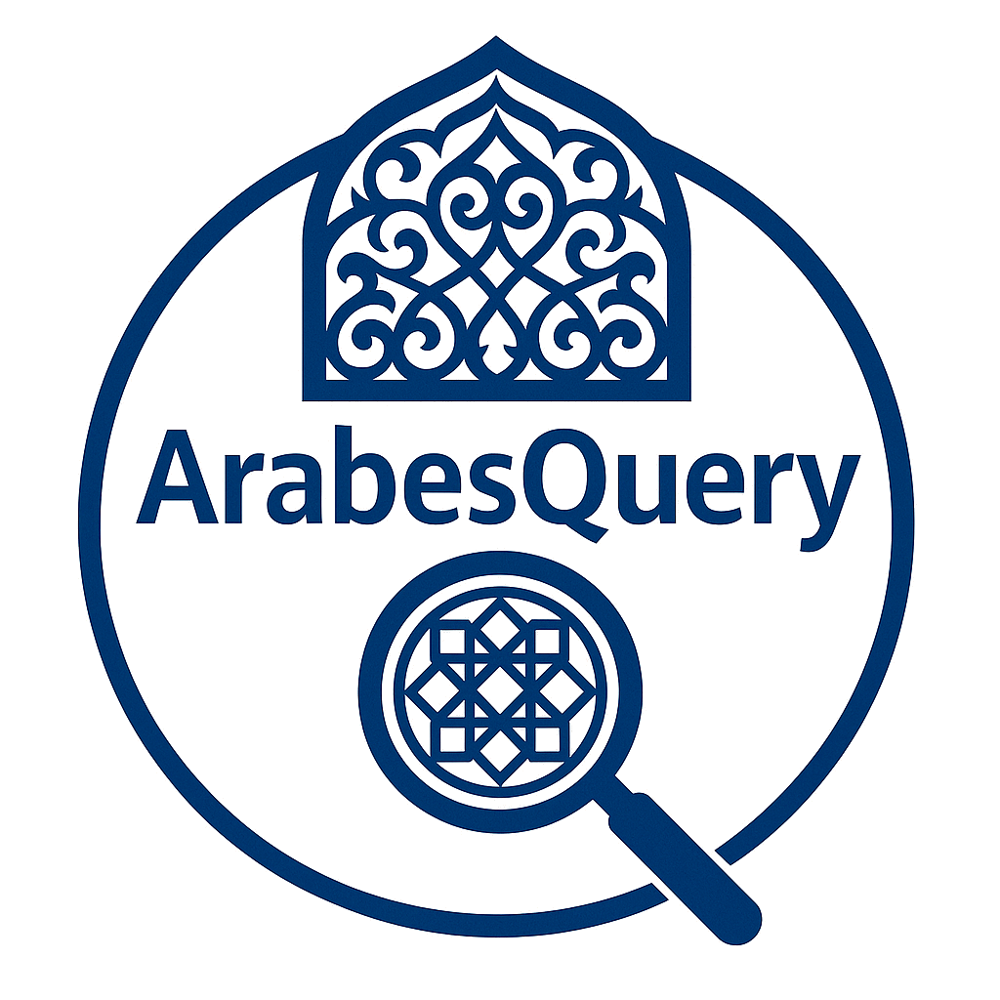

[2a] Computational Typology of the Arabic Written Tradition

Maxim Romanov

Universität Hamburg

ERC Consolidator Grant 2026 · interview

Part 3 · Research at the Escuela

Notes:
ArabesQuery investigates the Arabic written tradition as an interconnected and historically changing system of knowledge.

--- text class="q1"
<!-- reuse 2026-erc-interview:2 -->

[2a] ArabesQuery

How did its <b>branches of knowledge</b> (<i>ʿulūm</i>) emerge, interact, and change across time and space?

How did changes in the written tradition relate to shifts in scholarly geography and wider social, cultural, and political transformations?

Why did some textual types retain their presence, while others became more prominent or declined?

The Arabic written tradition as an interconnected whole

Part 3 · Research at the Escuela

Notes:
For centuries, scholars writing in Arabic organized knowledge into branches such as law, medicine, history, and Qurʾānic interpretation. We have rich studies of individual branches and extensive bibliographies. What remains unclear is how these branches fitted together: how distinct they were, how they interacted, and how those relationships changed across time and space. ArabesQuery addresses this question through systematic analysis of the texts, in dialogue with the tradition’s own classifications.

--- text max=44
<!-- reuse 2026-erc-interview:6 -->

[2a] ArabesQuery

# Reconstructing the tradition through its texts

<svg viewBox="0 0 1600 78" preserveAspectRatio="none" aria-hidden="true"><path d="M1400 72 V 24 Q1400 10 1386 10 H214 Q200 10 200 24 V 64" fill="none" stroke="var(--red)" stroke-width="2" stroke-dasharray="8 8"/><path d="M190 56 L200 72 L210 56" fill="none" stroke="var(--red)" stroke-width="2"/></svg>

interpretation refines the profiles

1

Identify textual profiles

Recurring types, and their combinations within works.

2

Test their robustness

Vary the exemplars; compare across authors, periods, and model settings; read the uncertain and mixed cases.

3

Connect the evidence

Texts, bibliographical classifications, and scholarly biographies.

4

Interpret historical change

Disciplines and their relationships across time and space.

Continuity and transformation: a type may stay recognizable while its composition and its place in the tradition change.

Corpus through corpus, bibliography through bibliography, supported with 604,000 biographies from EIS1600

Part 3 · Research at the Escuela

Notes:
The four stages shown here form a cycle. We vary the reference works used in training and repeat the analysis across authors and periods. We examine uncertain and mixed cases through close reading, allowing our categories to change. We then compare the profiles with bibliographical classifications and evidence about scholars’ activities and locations. Interpretation feeds back into modeling. A type may remain recognizable even as its internal composition and its place within the tradition change.

--- text p3 max=42
<!-- src: 2026-erc-interview:3 -->
<!-- P3.10 · Evidence · 45 seconds -->

[2a] ArabesQuery

# Connecting three bodies of evidence

**Texts — OpenITI** 
The composition of works and the relationships among their textual types.

**Bibliographies — the tradition’s own classifications** 
Authors, titles, and branches of knowledge, including works outside the digitized corpus.

**Biographies — EIS1600 and further sources** 
Authors’ scholarly activities and associations in time and place.

Compare textual patterns, historical classifications, and scholarly lives.

Part 3 · Research at the Escuela

Notes:
[45 seconds] These bodies of evidence provide different views of the tradition. OpenITI supports analysis of textual composition. Bibliographies such as Hadiyyaŧ al-ʿārifīn extend the view beyond the corpus and preserve historical classifications. Biographical evidence situates authors within scholarly life.

Their coverage and dependencies must be examined: a bibliography or a biographical collection is itself a historical source. Linking authors and works allows us to compare these perspectives without treating any one of them as a complete account. Credit the OpenITI collaborators and EIS1600 team for the foundations already presented in Part 2.

[ChAstra, C19] Example: follow a work’s textual profile, compare its bibliographical classification, and investigate its author’s recorded affiliations. This gives a concrete way to assess what linking the three bodies of evidence adds.

--- text p3 max=42
<!-- P3.13 · Corpus expansion and OCR · 60 seconds -->
# [2b] Expanding the OpenITI Corpus through Automated OCR

Estimated pool for expansion

**≈50,000 digitized volumes / PDFs** 
**≈25,000 distinct works**, subject to bibliographical reconciliation

- developed within the EIS1600 project
- automaticaly identfies bibliographical details: author, title, edition, etc.  
- uses multiple models to OCR the same page
- compares multiple OCR outputs identifying and fixing disagrements
- produces fully structured, clean texts (paratextual information removed)

Expanding OpenITI from 8,600 to 25,000–32,000 unique texts.

Part 3 · Research at the Escuela

Notes:
[60 seconds] These are working estimates of the available expansion opportunity, not counts of completed transcriptions. PDFs, volumes, editions, and distinct works must be reconciled bibliographically. The research value is broader coverage across periods, regions, and types of writing, including areas poorly represented in the present corpus.

The existing workflow adapts the logic of double-keying: produce multiple OCR readings, align them, identify disagreements, and check uncertain passages against the images. Conventional OCR and vision-language models can provide complementary outputs, although agreement does not guarantee correctness because systems can share errors. Textual structure also matters: headings, paragraphs, poetry, and notes are evidence for analysis.

Begin with selections justified by research questions. Large-scale processing can grow with collaboration and resources.

The recognition and metadata workflow is already operational. Describe the expansion target separately from completed, reconciled text releases.

--- text p3 max=44
<!-- P3.14 · Manuscripts, transmission, and reception · 65 seconds -->
# [2c] From production to transmission and reception

- Where and for how long did a work circulate?
- Which communities copied, owned, read, or taught it?
- Which texts were assembled, reused, or adapted together?

**Manuscript witnesses connect texts to histories of copying and use.**

Selective studies and text-reuse analysis · Broader manuscript collaboration through the proposed ʿAlamāt project

Part 3 · Research at the Escuela

Notes:
[65 seconds] The preceding slides address cultural production. Manuscript evidence allows us to extend the investigation into transmission and reception. Composition, copying, and later use are different historical events. Multiple witnesses, composite volumes, ownership and reading notes, and textual adaptations provide evidence for different parts of those histories.

Text-reuse analysis can help identify relationships among works, while material evidence situates copying and use. Recognition methods help make these sources available for comparison, but variation, attribution, and cataloging remain scholarly problems to investigate.

Selective studies can begin through collaboration. The proposed German Akademie project, ʿAlamāt, offers a potential route to broader manuscript work; it is not secured funding or an already available Escuela resource. The printed-volume estimates on the previous slide are separate from this manuscript agenda.

--- text p3 max=44
<!-- P3.15 · Language evolution · 60 seconds -->
# [3a] Language evolution at several levels

**How did Arabic change across the written tradition?**

- **Morphology:** forms and their distribution.
- **Syntax:** constructions and patterns of combination.
- **Lexicon:** vocabulary, meanings, and contexts of use.

Detailed textual annotation can extend the analyses begun in the book.

Part 3 · Research at the Escuela

Notes:
[60 seconds] The book demonstrated ways to investigate linguistic patterns, but it could not provide a detailed morphological, syntactic, and lexical history across the corpus. As language-processing methods improve, we can annotate texts more richly and examine change at several levels.

The research questions lead this work. Which forms or constructions become more common? Which vocabulary changes its distribution or contexts of use? How do these developments vary among textual types? Lexical annotation helps investigate changes in meaning, but interpretation still requires reading passages in context.

Begin with selected features and validated subsets, then extend the coverage as methods improve. Chronology, textual type, regional distribution, and corpus composition must be considered together.

--- text p3 max=44
<!-- P3.16 · Regional language variation · 60 seconds -->
# [3b] Classical Arabics?

**Did Classical Arabic in the West differ from Classical Arabic in the East?**

- Compare regional usage within comparable periods and textual types.
- Trace whether differences persisted, shifted, or converged.
- Relate linguistic patterns to intellectual and social contexts.

Part 3 · Research at the Escuela

Notes:
[60 seconds] Classical Arabics is a question, not a conclusion assumed in advance. A broader corpus, geographical information, and detailed textual annotation make it possible to compare language across regions while taking account of period and textual type.

West and East provide an initial question rather than an exhaustive geographical division. We also need to distinguish regional patterns from the habits of particular authors, uneven source coverage, and the effects of transmission. The Escuela’s expertise in the western Islamic world would be especially valuable in designing and interpreting these comparisons.

This direction connects the linguistic agenda with both the textual and the social-historical strands.

[ChAstra, C19] Example: compare one construction in western and eastern legal prose from the same period. Inspect the passages and repeat the comparison across authors.

--- text p3 max=44
# Sharing the research

- Publish historical and philological findings alongside documented corpora and models.
- Provide worked examples and research applications through which others can explore the evidence.
- Share results through workshops, public demonstrations, and accessible accounts of the historical questions.

Part 3 · Research at the Escuela

Notes:
Connect dissemination to the forms of output already demonstrated in the talk. The book communicates the interpretation and methods. Research applications let colleagues explore and test them. Public talks and demonstrations can explain what the evidence changes about our understanding of the past. Choose suitable formats with the Escuela. [25–30 seconds; responds to José’s suggestion about dissemination]

--- text p3 max=42
<!-- P3.18 · Initial priorities · 55 seconds -->
# Initial priorities at the Escuela (no funding)

**Historical research** 
Continue the work on the two syntheses using EIS1600’s data and foundational volumes.

**Typology of the Arabic written tradition** 
Begin the work on computational typology.

**Shared research practice** 
Shape initial collaborations with colleagues and organize a focused training activity.

The data, methods, and instruments are already in place to begin.

Part 3 · Research at the Escuela

Notes:
[55 seconds] These priorities establish how the program can begin using the corpora, methods, and instruments already developed. My main sustained writing would be the historical and historiographical syntheses. Focused typological studies and preparation of author–work links would develop the textual agenda alongside them.

With colleagues, I would identify suitable opportunities for consultation, collaboration, and an initial training activity. Instrument development would address the needs arising from these investigations. This is a sequence of priorities rather than a fixed annual delivery schedule; the practical arrangements would be developed at the Escuela.

Larger corpus expansion, recruitment, and extensive manuscript integration can grow with additional resources. The next slide explains how funding would change the scale and organization of the program.

--- text p3 max=42
<!-- P3.19 · Leadership and funding · 50 seconds -->
# Research leadership and external funding

**Spanish national funding · AEI 2027** 
Develop a *Proyectos de Generación de Conocimiento* proposal with colleagues, with associated predoctoral funding where appropriate.

**European funding · ERC** 
If ArabesQuery is funded, both historical-historiographical research can continue in parallel with the study of the typology of the Arabic written tradition.

**German funding · *ʿAlamāt* Akademie Projekt** 
a 25-year project proposal is in active development in collaboration with Professor Beatrice Gruendler (Freie Universität Berlin) and Professor Jens Scheiner (Göttingen)—the project extends the ambition of ArabesQuery into manuscripts. 

The AEI application will follow the published terms of the 2027 call.

Part 3 · Research at the Escuela

Notes:
[50 seconds] EIS1600 has given me experience coordinating research, supervising researchers, and bringing individual contributions into shared outputs. Service on three ERC Consolidator panels also informs my understanding of proposal development; refer only to general experience, not confidential material or influence over decisions.

If ERC funding is awarded, the team would carry out the lion’s share of ArabesQuery’s work under my scientific direction. This organization would allow me to complete the EIS1600 syntheses and prepare their evidence for the mapping-tradition component while maintaining the project’s intellectual integration.

The initial priorities just outlined can proceed without assuming that grant. Further Spanish and international funding would support larger collaborations, recruitment, corpus expansion, and training. Developing proposals is also an area in which I can contribute to joint work at the Escuela.

Article 8.2(b)(3) of the 2026 AEI call accepts documented expectation of appointment following a successful competitive public-sector selection. The 2027 application will depend on that call’s published terms. José’s indicative humanities budgets are planning guidance, so omit a numerical budget from the projected slide. Predoctoral support would require an appropriate research and supervision plan.

The submitted Hamburg plan provides for a computational/DH postdoctoral position and two sequential subject postdoctoral appointments. Any revised recruitment structure at CSIC would depend on the agreed budget and grant arrangements. Maxim retains scientific direction and integration.

--- text max=40
# To conclude

My proposition is that:

> digital Arabic philology allows us to study the Arabic written tradition as a whole through a unified, machine-readable corpus. We can ask how scholarly communities changed, how texts drew on one another, how their typology developed, and how Arabic itself evolved. And we can move from a single passage to patterns across centuries and regions, then return to the passages and their contexts to see what those patterns mean. And never lose the sight of the big picture.

Part 3 · Research at the Escuela

Notes:
My proposition is that digital Arabic philology allows us to study the Arabic written tradition as a whole through a unified, machine-readable corpus. We can ask how scholarly communities changed, how texts drew on one another, how their typology developed, and how Arabic itself evolved. And we can move from a single passage to patterns across centuries and regions, then return to the passages and their contexts to see what those patterns mean. And never lose the sight of the big picture.

--- section light

# Thank you

Maxim Romanov · Universität Hamburg

Notes:
Thank you. I look forward to your questions.
