--- title
Notes:
Outline Cover: Opening. Planned time: 30 seconds.

Introduce the four-part argument: the state of the field, my contributions, future developments, and the research program I would pursue at the Escuela. Target 50 minutes including demonstrations. The schedule below is a rehearsal budget, not a measured delivery time.

## Editorial handoff to Claude Code

This is the requested draft source folder, not the assembled presentation. Preserve the user's slide system and use its `assemble.py` followed by `build_one.py`. Reuse directives resolve to editable source slides on Maxim's machine. The exported presentation library provides pictures for preview where original source images are absent.

All 37 lettered units of the November 16 detailed outline are represented. Additional screens retain the book sequence and case-study evidence. The current user’s corrections override earlier wording: social history and historiography are the primary continuing line; the first three volumes have a drafting target of EIS1600’s end; the two syntheses continue at EEA; historiography emerged beyond the initial project remit; ERC team work is conditional; language questions lead and tools follow.

This is a complete first assembly for Maxim's editorial pass. Timing is an allocation, not a tested speaking duration. It totals 50 minutes, including both demonstrations. The original 60-minute ceiling leaves a nominal ten-minute margin. Rehearse and cut if necessary.

The only new-adaptation image paths come from the supplied book block. No new figures or imagery are needed. Supply its original images through the normal source lookup. The exact book macroperiod bounds have been checked against the supplied monograph. Existing map figures use narrower windows that exclude transitions; retain that distinction.

One small content change to the supplied book sequence: the first slide’s “3 of 11” count has been removed because its own notes leave that count undecided. The supplied critical assessments remain for Maxim’s review. KITAB volumes remain forthcoming.

Validation here: format-demo and this draft build successfully; all 58 slides have notes and all visible images resolve; static page layouts were reviewed. The environment blocked browser automation, so live JavaScript auto-fit, navigation, speaker-window behavior, and the final editable assembly still need checking in the browser on Maxim's machine. Existing figures appear as pictures only in the exported-library preview, as expected.

## Reused-slide cue sheet

Reused slides retain their source notes. These additional timing/transition cues belong to this talk.

- Slide 05, 1.C, 40 seconds, 2026-11-16-dh-books-soa:2: Use the supplied slide and its notes. Keep this to its main methodological contribution. These slides articulate the speaker’s assessment of the field.

- Slide 06, 1.C, 40 seconds, 2026-11-16-dh-books-soa:3: Use the supplied slide and its notes. Keep this to its main methodological contribution. These slides articulate the speaker’s assessment of the field.

- Slide 07, 1.C, 40 seconds, 2026-11-16-dh-books-soa:4: Use the supplied slide and its notes. Keep this to one contribution and one limitation. The KITAB volumes are forthcoming as of this presentation; do not describe them as already published.

- Slide 08, 1.C, 40 seconds, 2026-11-16-dh-books-soa:5: Use the supplied slide and its notes. Keep this to its main methodological contribution. These slides articulate the speaker’s assessment of the field.

- Slide 16, 2.D, 35 seconds, 2026-09-28-Cairo:13: Explain axes and the difference between absolute and relative frequency. This is the existing book figure; do not imply that it is a fresh run of the application. Move into the demonstration.

- Slide 20, 2.E, 35 seconds, 2026-09-28-Cairo:30: Explain the vertical chapter boundaries and identify one change in profile. Return to the interpretive question: why does Ibn al-Jawzī draw on different kinds of writing in different parts of his argument?

- Slide 22, 2.F, 60 seconds, 2026-09-28-Cairo:39: Explain leaves as fifty-year corpus intervals and proximity as modeled similarity. Dates on this figure are Hijrī. One tree illustrates the comparison; the next slide tests whether its broad structure persists.

- Slide 23, 2.F, 50 seconds, 2026-09-28-Cairo:41: Explain recurring blocks across the stripe diagrams rather than each parameter combination. Stylistic and thematic analyses offer different views. The broad divisions motivate a historical interpretation, with transitions and internal variation.

- Slide 24, 2.F, 30 seconds, 2026-09-28-Cairo:47: These geographical figures derive from Hadiyyaŧ al-ʿārifīn, a separate body of evidence. Introduce its authors and places before interpreting Iraq and Iran. The map’s date window and denominator belong to the source figure; the final summary gives the book’s full macroperiod boundaries.

- Slide 25, 2.F, 30 seconds, 2026-09-28-Cairo:48: Show the concentration in Egypt and Syria. The figure excludes transitional intervals; its 701–900 AH label is narrower than the middle macroperiod, 601–950 AH. Say this explicitly rather than treating the map window as the period boundary.

- Slide 26, 2.F, 30 seconds, 2026-09-28-Cairo:49: Show the more polycentric geography, including Anatolia and India. The displayed map uses a narrower, post-transition window than the full late macroperiod. These are patterns in the biobibliographical source, not an exhaustive map of all scholarly life.

## Full rehearsal schedule

| Slide | Outline | Seconds | Topic |
|---|---|---:|---|
| 1 | Cover | 30 | Digital Arabic Philology |
| 2 | 1.A | 50 | A field taking shape |
| 3 | 1.B | 45 | The precedent of prosopography |
| 4 | 1.C | 40 | Muhanna: an early collective statement |
| 5 | 1.C | 40 | Van Lit: working with digital manuscripts |
| 6 | 1.C | 40 | An Unruly Classic: variation and transmission |
| 7 | 1.C | 40 | KITAB: The Making of the Arabic Book |
| 8 | 1.C | 40 | A proposition for the field |
| 9 | 1.D | 40 | Connecting the existing components |
| 10 | 1.E | 60 | The tradition through its interconnections |
| 11 | 1.F | 30 | From a proposition to its realization |
| 12 | 2.A | 75 | The book’s four connected domains |
| 13 | 2.B | 70 | OpenITI as a scholarly foundation |
| 14 | 2.C | 50 | Philological instruments embody methods |
| 15 | 2.D | 65 | When did “the six books” become a designation? |
| 16 | 2.D | 35 | The distribution of al-kutub al-sittaŧ |
| 17 | 2.D | 120 | From a distribution to its passages |
| 18 | 2.E | 45 | What kinds of writing make up a book? |
| 19 | 2.E | 110 | A consistent profile and a varied composition |
| 20 | 2.E | 35 | Talbīs Iblīs: rolling assessment |
| 21 | 2.F | 75 | Rethinking historical periodization |
| 22 | 2.F | 60 | One dendrogram |
| 23 | 2.F | 50 | Patterns across repeated analyses |
| 24 | 2.F | 30 | Early geographical pattern |
| 25 | 2.F | 30 | Middle geographical pattern |
| 26 | 2.F | 30 | Later geographical pattern |
| 27 | 2.F | 65 | Three macroperiods of the written tradition |
| 28 | 2.G | 50 | Quantitative evidence and interpretive analysis |
| 29 | 2.H | 75 | EIS1600: biographies linked across collections |
| 30 | 2.H | 70 | Three volumes establish the research foundation |
| 31 | 2.H | 40 | A related study of monetary equivalents |
| 32 | 2.I | 40 | A foundation for sustained research |
| 33 | 3.A | 45 | Toward a connected history of the tradition |
| 34 | 3.B | 60 | ArabesQuery: the historical organization of writing |
| 35 | 3.C | 70 | Two complementary views of the tradition |
| 36 | 3.D | 50 | Writing in its social and geographical settings |
| 37 | 3.E | 45 | Expanding the printed corpus |
| 38 | 3.F | 50 | Comparing OCR outputs improves the evidence |
| 39 | 3.G | 45 | Manuscripts extend the evidence |
| 40 | 3.H | 50 | From production to transmission and reception |
| 41 | 3.I | 70 | Language evolution at several levels |
| 42 | 3.I | 70 | Classical Arabics? |
| 43 | 3.I | 40 | Instruments for rapid hypothesis checks |
| 44 | 3.J | 30 | A disciplinary program that can accumulate |
| 45 | 4.A | 50 | A continuing historical program at the Escuela |
| 46 | 4.B | 40 | Four continuing research lines |
| 47 | 4.B | 75 | Historiographical synthesis: how the sources shape the past |
| 48 | 4.B | 80 | Historical synthesis: interpreting social transformation |
| 49 | 4.C | 45 | A Digital Arabic Philology Laboratory |
| 50 | 4.D | 45 | A methodological collaborator within the Escuela |
| 51 | 4.E | 35 | Research outputs that others can use |
| 52 | 4.F | 45 | An established network for collaborative research |
| 53 | 4.G | 45 | Training through research apprenticeship |
| 54 | 4.H | 45 | Workshops and summer schools |
| 55 | 4.I | 40 | My research and a potential ArabesQuery team |
| 56 | 4.J | 40 | Leadership and external funding |
| 57 | 4.K | 85 | What I can begin with existing resources |
| 58 | 4.L | 30 | The proposition for Granada |

--- agenda max=48
# Structure

State of the field
My contributions
Future development
My research program at Granada

Notes:
[20 sec] Four parts: the state of the field; my contributions; where the field can go next; and the research program I propose for the Escuela. The part is shown at the top of every slide.

--- section light partdiv
<!-- divider · Part 1 -->

Part

1

# State of the field

What digital Arabic philology can investigate, and what still holds it back

Notes:
Part 1: State of the field.

--- text max=44

# A field taking shape

- Valuable projects, corpora, and computational methods already exist.
- Their integration into a cumulative research practice remains uneven.
- The next step is to connect evidence and methods across successive studies.

Part 1 · State of the field

Notes:
Outline 1.A: Digital Arabic philology remains unevenly consolidated. Planned time: 50 seconds.

Acknowledge existing achievements without claiming that colleagues work in isolation. The issue is how particular results become part of a sustained inquiry into the Arabic written tradition. Transition to an important precedent: biographical research.

--- text max=44
# The precedent of prosopography

<i>Onomasticon Arabicum</i> Netherlands Ulama Project <i>Prosopografía de los ulemas de al-Andalus</i>

- Evidence organized across many sources
- Shared structures for systematic comparison
- Long-term accumulation of scholarly knowledge

A foundation for extending cumulative research across the written tradition.

Part 1 · State of the field

Notes:
Outline 1.B: Prosopography provides an important precedent. Planned time: 45 seconds.

Explain the intellectual precedent rather than judging software age or current project activity. PUA is particularly relevant to the Escuela and to the continuing social-history program. Source: agreed outline 1.B and submitted VISIÓN, sections 1 and 4.

--- text bkc nofit
<!-- src: 2026-11-16-dh-books-soa:1 -->

2016202020242026

2016 · the first attempt

The Digital Humanities and Islamic &amp; Middle East Studies

Elias Muhanna (ed.)

Berlin: De Gruyter, 2016 · doi.org/10.1515/9783110376517

Reflection on digital scholarship alongside computational case studies

Most contributions reflect on “the digital” rather than practice it.

Part 1 · State of the field

Notes:
Outline 1.C: Book-length contributions show a field taking shape. Planned time: 40 seconds.

Introduce the first volume in the supplied book sequence. Preserve the distinction between reflecting on digital scholarship and applying computational methods. Editorial change: removed the unverified “3 of 11” count because the supplied notes explicitly leave the classification undecided. The rest of the supplied critical framing is retained. Transition to digital manuscript work.

<!-- reuse 2026-11-16-dh-books-soa:2 -->
--- text bkc nofit

2016202020242026

2020 · a handbook of tools

Among Digitized Manuscripts: Philology, Codicology, Paleography in a Digital World

L.W.C. van Lit

Handbook of Oriental Studies 137 · Leiden: Brill, 2020 · open access · doi.org/10.1163/9789004400351

<ul class="facts">
<li>Digitized versus physical manuscripts; twenty online repositories ranked by ten criteria</li>
<li>TEI, IIIF, catalog databases, Python and OpenCV</li>
</ul>

Formats and tools, but no research question and no analytical result.

Part 1 · State of the field

Notes:
Four years later, Brill published Cornelis van Lit's Among Digitized Manuscripts in the Handbook of Oriental Studies. It discusses how digitized manuscripts differ from physical ones, ranks twenty online repositories by criteria such as resolution, color, and download options, and introduces TEI, IIIF, cataloging, and image processing with Python and OpenCV, ending with an autobiographical postscript. Reviewers were kind: Philip Bockholt called it a welcome contribution (MIDÉO 37, 2022). My own reading is less generous. The book explains formats and tools, but it does not pose a historical or philological question and it produces no analytical result. That is a problem for the field: it presents digital humanities as a technical service rather than a way of doing research.
[Bockholt, review of van Lit, MIDÉO 37 (2022): 215–218, journals.openedition.org/mideo/8299. Chapter list from the review: 1 manuscript, print, digital worlds; 2 digital materiality; 3 twenty repositories, an ethnography; 4 paleography; 5 digital editing standards (TEI); 6 cataloging; 7 codicology with Python and OpenCV; 8 “A Digital Orientalist”; postscript after Kračkovskij.]

<!-- reuse 2026-11-16-dh-books-soa:3 -->
--- text bkc nofit

2016202020242026

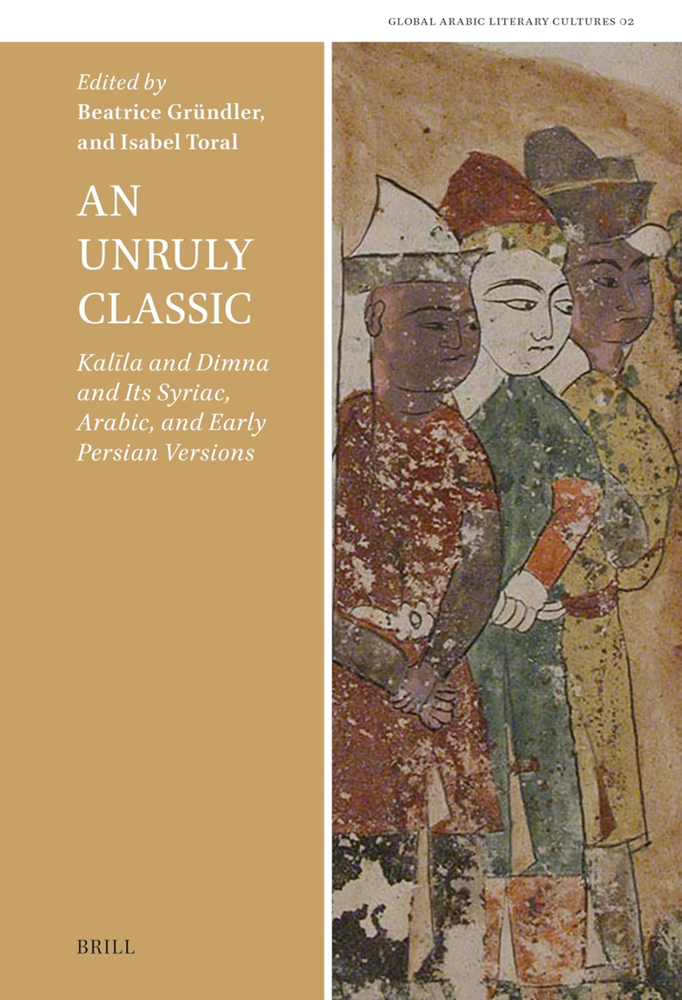

2024 · a project and its infrastructure

An Unruly Classic: Kalīla and Dimna and Its Syriac, Arabic, and Early Persian Versions

Beatrice Gründler and Isabel Toral (eds.)

Global Arabic Literary Cultures 2 · Leiden: Brill, 2024 · open access · doi.org/10.1163/9789004693579

<ul class="facts">
<li>Variation and mutability across the versions of one text</li>
<li>The digital infrastructure the project needed, including a chapter on its software</li>
</ul>

Digital infrastructure in the service of a question, but a single textual tradition.

Part 1 · State of the field

Notes:
A more engaging example came in 2024 from the Kalīla and Dimna project in Berlin: An Unruly Classic, edited by Beatrice Gründler and Isabel Toral. The volume studies variation and mutability across the Syriac, Arabic, and early Persian versions of one text, and it engages with the digital infrastructure such a project needs — there is a chapter on the software the project used. Here the digital work serves a philological question. But it remains a case study of a single, if unruly, textual tradition; it does not tell us what the approach can do for the written tradition as a whole.
[Chapters (Crossref): Gründler and Toral, introduction; Gründler, Arabic versions as continua; Khalfallah, the chapter of the king and his dreams; Redwan, illustrations; van Ginkel, friendship; Beers, Naṣr Allāh Munšī’s preface; Toral, the panther and the fox; Stephan, poetic moments; Kozae, software use in the project; lists of manuscripts.]

<!-- reuse 2026-11-16-dh-books-soa:4 -->
--- text bkc nofit

2016202020242026

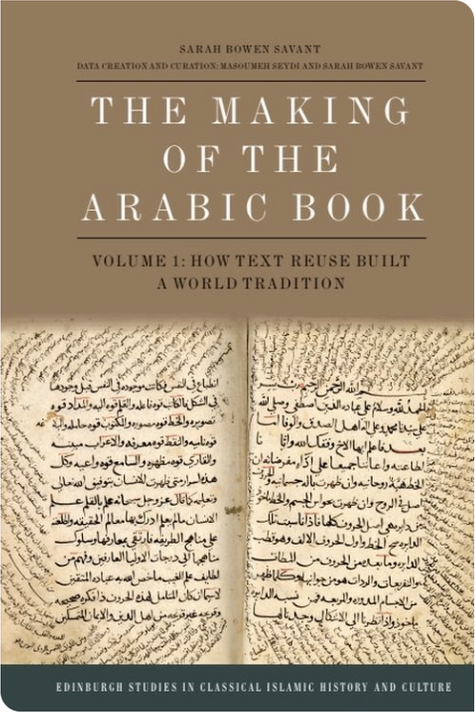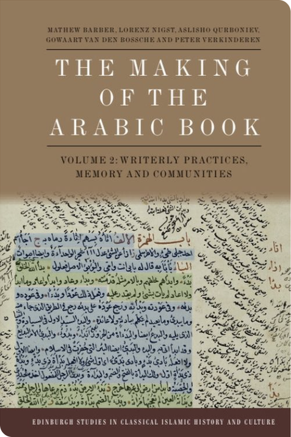

2026 · the KITAB results

The Making of the Arabic Book

<b>Vol. 1:</b> <i>How Text Reuse Built a World Tradition</i>. Sarah Bowen Savant <b>Vol. 2:</b> <i>Writerly Practices, Memory and Communities</i>. Mathew Barber, Lorenz Nigst, Aslisho Qurboniev, Gowaart Van Den Bossche, Peter Verkinderen

Edinburgh University Press, December 2026 · open access

<ul class="facts" style="font-size:28px;margin-top:22px">
<li>Text reuse across more than a billion words of Arabic, c. 700–1500 CE</li>
<li>How authors reused texts, how they described it, what it did to the tradition</li>
</ul>

<b>Shared foundation</b>OpenITI: the corpus and methods described in chapter 2 of my book, which also underlie EIS1600

Part 1 · State of the field

Notes:
And this year the field gets its first large-scale results. The KITAB project publishes The Making of the Arabic Book in two open-access volumes with Edinburgh University Press: Sarah Bowen Savant's How Text Reuse Built a World Tradition, and a second volume by Mathew Barber, Lorenz Nigst, Aslisho Qurboniev, Gowaart Van Den Bossche, and Peter Verkinderen on writerly practices, memory, and communities. They trace text reuse across more than a billion words of Arabic from roughly 700 to 1500 and ask how authors reused texts, how they themselves described the practice, and what it did to the written tradition. These books form a cluster with mine: the corpus they rest on, OpenITI, is described in the second chapter of my book, and it is also the foundation of my EIS1600 project.
[Edinburgh University Press pages (published December 2026, pre-order as of Nov. 16): edinburghuniversitypress.com/book-the-making-of-the-arabic-book-volume-1.html and …-volume-2.html. Vol. 1 cover: “Data creation and curation: Masoumeh Seydi and Sarah Bowen Savant.” Vol. 2 case studies: Mālikī scholars of North Africa, Ismaʿili communities of northwest Syria, Fatimid, Ayyubid and Mamluk historiography, the Iḫwān al-Ṣafāʾ.]

<!-- reuse 2026-11-16-dh-books-soa:5 -->
--- text bkc nofit

2016202020242026

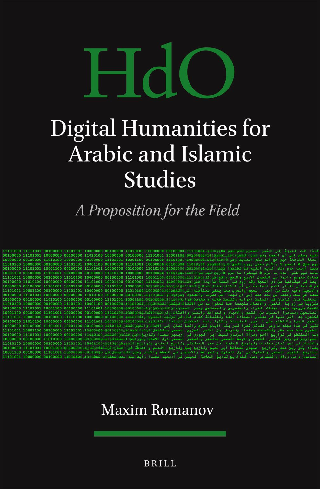

2026 · a proposition for the field

Digital Humanities for Arabic and Islamic Studies: A Proposition for the Field

Maxim Romanov

Handbook of Oriental Studies 199 · Leiden: Brill, 2026 · doi.org/10.1163/9789004760530

<ul class="facts">
<li><b>Why:</b> the scale of the written tradition and the limits of reading it text by text</li>
<li><b>How:</b> a corpus built for research: OpenITI, mARkdown, URIs, versioned releases</li>
<li><b>What it gives:</b> term histories, textual typology, linguistic periodization</li>
</ul>

What should digital humanities in our field be, and what can it give us?

Part 1 · State of the field

Notes:
My own book, published by Brill this year in the same series as van Lit's, is an attempt to propose a coherent vision of what digital humanities can be for our field. It makes the case in three steps. Why: the written tradition is too large to be understood text by text, and we need ways to read it as a whole. How: a corpus designed for research — OpenITI, its mARkdown annotation, URIs, and versioned releases, the foundation that KITAB and EIS1600 share. And what it gives: three case studies with historical results — the history of a term (the six books), a typology of Arabic writing, and a periodization based on language and themes. This is the segue: what should digital humanities in our field be, and what can a proper implementation give us?
[Book structure: A Pitch for Digital Humanities; Digital Avatars and Metaobjects (OpenITI: corpus design, mARkdown, URIs, metadata, releases); Computational Inquiries, Case Studies 1–3 (tracing term usage; modeling textual typology; charting linguistic evolution).]

--- section light partdiv
<!-- divider · Part 2 -->

Part

2

# My contributions

Methods, instruments, and historical results

Notes:
Part 2: My contributions.

--- text domains max=44
<!-- src: 2026-09-22-fub-keynote:17 -->

# The Proposition: <em>Four Domains</em>

IDigital AvatarsMachine-readable editions of manuscripts and printed books

IIMetaobjectsCorpora, databases, and linked open data at scale

IIIComputational MethodsStatistics, stylometry, and NLP adapted for Arabic

IVNetworksKnowledge networks: text, person, place, and time connected

The domains connect the construction of evidence with historical interpretation.

Part 2 · My contributions

Notes:
Outline 2.A: The book’s proposition: four connected domains. Planned time: 75 seconds.

Explain the four domains: digital representations of material objects; metaobjects such as corpora and databases; computational methods; and networks of knowledge. Interpretation informs work throughout. These are the book’s methodological domains. They are distinct from VISIÓN’s four research axes: texts, textual types, transmission, and language.

--- text max=44
<!-- reuse 2026-09-28-Cairo:4 -->
# The same framing at every scale

١A wordis understood through the words around it: its company restricts its meaning

٢A termis understood through the corpus: when does it appear across time and space? who uses it? and who doesn’t?

٣A bookis understood through other books: what other books it builds on? how does it fit among the rest?

٤A traditionis understood through the geographical and chronological layers of books: how does its language change? how do its topics shift?

Part 2 · My contributions

--- section light
<!-- reuse 2026-09-28-Cairo:5 -->

The instrument

# A Proxy to the Arabic Written Tradition

OpenITI as a chronological and geographical representation

Part 2 · My contributions

--- text max=44
<!-- reuse 2026-09-28-Cairo:6 -->
# OpenITI <a href="https://github.com/OpenITI">github.com/OpenITI</a>

<b>8,700+</b>titles

<b>3,300+</b>authors

<b>2.4 billion</b>words, all versions

Nigst, Lorenz, Maxim Romanov, Sarah Bowen Savant, Masoumeh Seydi, and Peter Verkinderen. <em>OpenITI: A Machine-Readable Corpus of Islamicate Texts, Primary Version.</em> Version 2025.1.9. Zenodo, 2026. <a href="https://doi.org/10.5281/zenodo.18613982">doi.org/10.5281/zenodo.18613982</a>

Part 2 · My contributions

--- text max=44
<!-- reuse 2026-09-28-Cairo:7 -->
# OpenITI, v. 2023.1.8 — “clean”

Our final subcorpus, based on version 2023.1.8, consisting solely of “clean” unique texts written up to 1400/1980:

<ul class="plain">
<li>– 2,783 unique authors (156 fewer than in the set above, or 94.69%)</li>
<li>– 7,058 unique texts (−407 fewer, or 94.55%)</li>
<li>– 927.37 million tokens before cleaning</li>
<li>– 868.81 million tokens after removal of most paraeditorial material and remaining “unclean” (93.68% of the uncleaned set)</li>
</ul>

Part 2 · My contributions

--- figure
<!-- reuse 2026-09-28-Cairo:8 -->

Part 2 · My contributions

--- figure
<!-- reuse 2026-09-28-Cairo:9 -->

Part 2 · My contributions

--- section light
<!-- reuse 2026-09-28-Cairo:10 -->

Case 1

# A term in time

When did <em>al-kutub al-sittaŧ</em> come to be?

Part 2 · My contributions

--- text steps max=44
<!-- reuse 2026-09-28-Cairo:11 -->
# Case 1: <em>al-kutub al-sittaŧ</em> (الكتب الستة)

In “The Devil’s Delusions” (<em>Talbīs Iblīs</em>), Ibn al-Jawzī (d. 597/1201) uses lots of <i>ḥadīṯ</i>s:

 

<em><strong>- &nbsp; No <i>isnād</i>s for</strong>: Muslim, al-Buḫārī, and Abū Dāwūd</em>

 

<em><strong>- &nbsp; Full <i>isnād</i>s for</strong>: al-Tirmiḏī, Ibn Mājah, and al-Nasāʾī</em>

 
 

No notion of <em>al-kutub al-sittaŧ</em> in the end of the 6th/12th century in Baġdād.

Part 2 · My contributions

--- figure
<!-- reuse 2026-09-28-Cairo:12 -->

Part 2 · My contributions

--- figure
<!-- reuse 2026-09-28-Cairo:13 -->
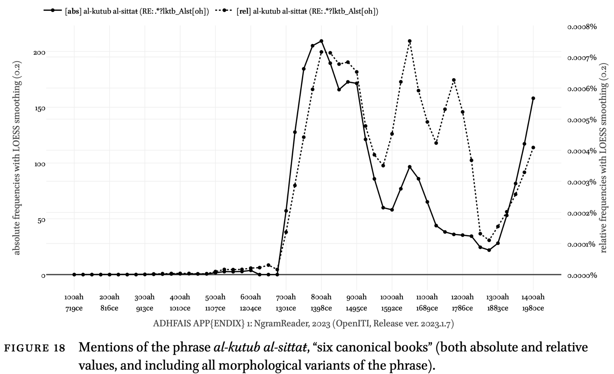

Part 2 · My contributions

--- figure
<!-- reuse 2026-09-28-Cairo:14 -->
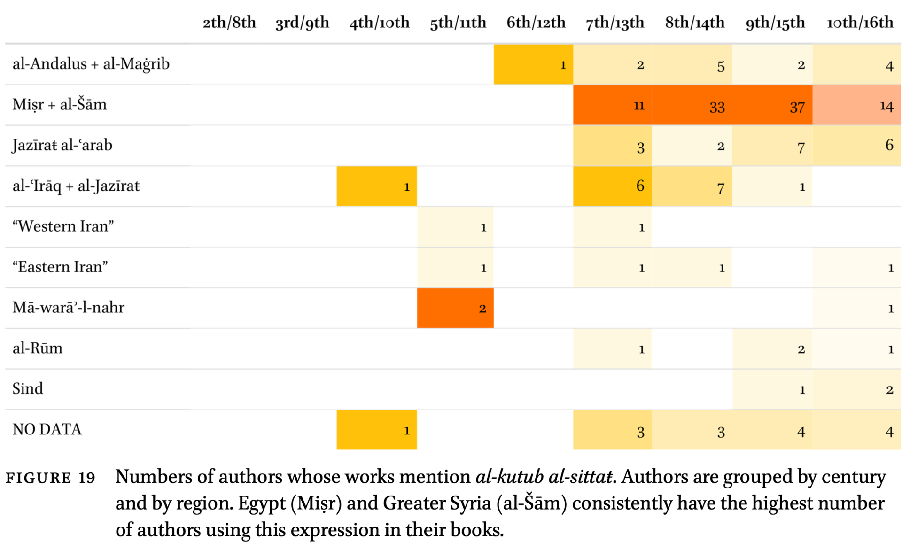

Part 2 · My contributions

--- section light
<!-- reuse 2026-09-28-Cairo:15 -->

Case 2

# A book among books

Text reuse and the modeling of text types

Part 2 · My contributions

--- section light
<!-- reuse 2026-09-28-Cairo:16 -->

Case 2a

# Text Reuse

By tracing at scale how later texts reuse earlier texts we can understand how each book fits into the tradition and how all the books form a network of interconnections

Part 2 · My contributions

--- split w-25-75 vcenter max=44
<!-- reuse 2026-09-28-Cairo:17 -->

- Among them was Abd Allãh b. Ḫāzim al-Sulamī, the governor of Ḫurāsān for Abd Allãh b. al-Zubayr. What was remarkable about him was that he was extremely brave and resourceful, yet he was terrified of mice. One day, while he was with ʿUbayd Allãh b. Ziyād, a white rat was brought before him and he was astonished. ʿUbayd Allãh said to ʿAbd Allãh, ‘O Abū Ṣāliḥ, have you ever seen anything more astonishing than this?’ And there was Abd Allãh, who had shrunk as if he were a chick and turned yellow as if he were a male locust. ʿUbayd Allãh then said, “Abū Ṣaliḥ disobeys the Merciful, takes lightly the authority, seizes the snake, walks toward the blooming lion, faces spears with his face and swords with his hands, and yet, he is overcome by a rat as you see. I testify that Allãh is capable of everything.

|||

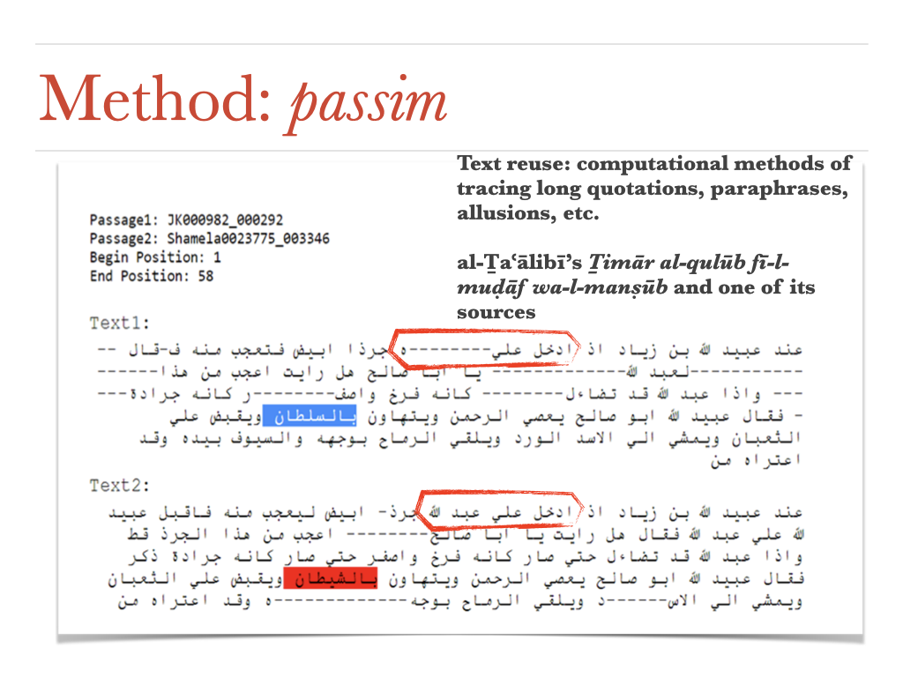

Part 2 · My contributions

--- text max=44
<!-- reuse 2026-09-28-Cairo:18 -->
# al-Ḏahabī and his <i>Tārīḫ al-islām</i>

Šams al-dīn al-Ḏahabī (d. 748/1348): historian, ḥadīṯ scholar, biographer.

<em>Tārīḫ al-islām</em> — a universal chronicle-cum-biographical collection covering seven centuries of Islamic history (1–700 AH / 622–1301 CE), organized decade by decade.

<ul>
<li>c. 30,000 biographies</li>
<li>c. 3 million words</li>
<li>Two modern editions: 50 vols. (Tadmurī) and 16 vols. (Maʿrūf)</li>
</ul>

Built largely from earlier sources — an ideal test case for text-reuse detection at scale.

Part 2 · My contributions

--- figure
<!-- reuse 2026-09-28-Cairo:19 -->

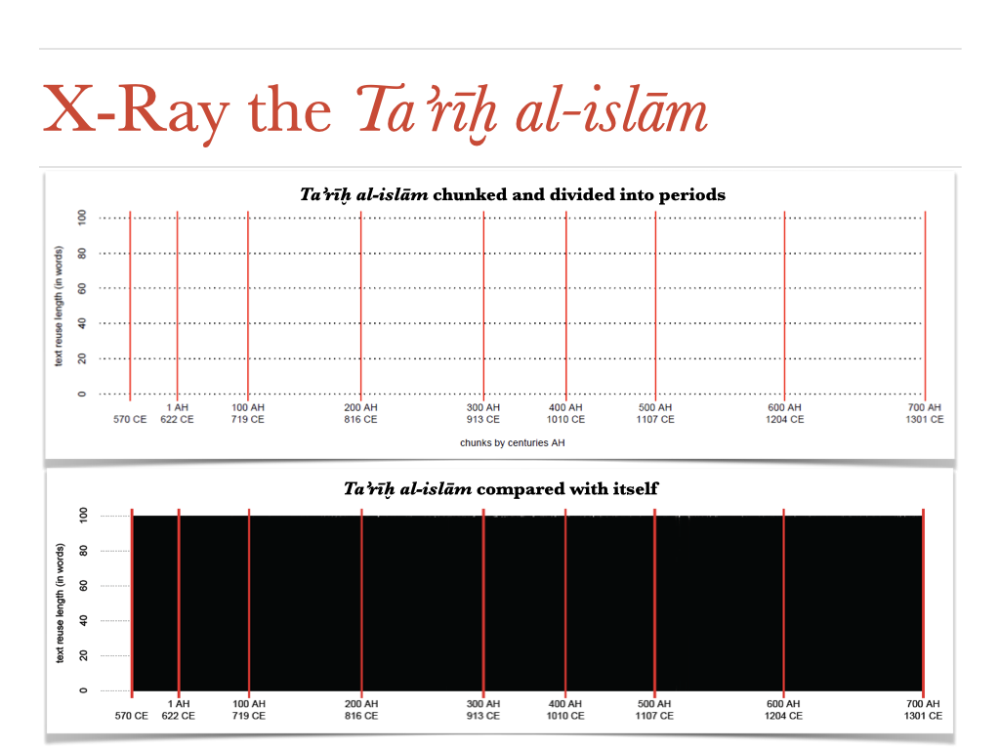

Part 2 · My contributions

--- figure
<!-- reuse 2026-09-28-Cairo:20 -->

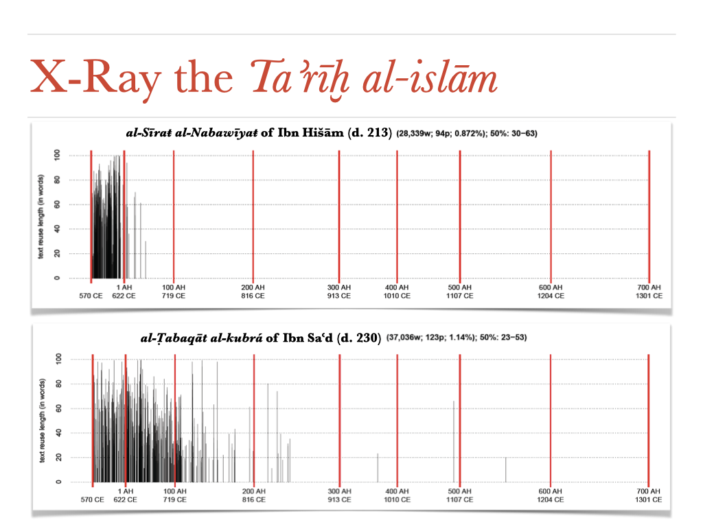

Part 2 · My contributions

--- figure
<!-- reuse 2026-09-28-Cairo:21 -->

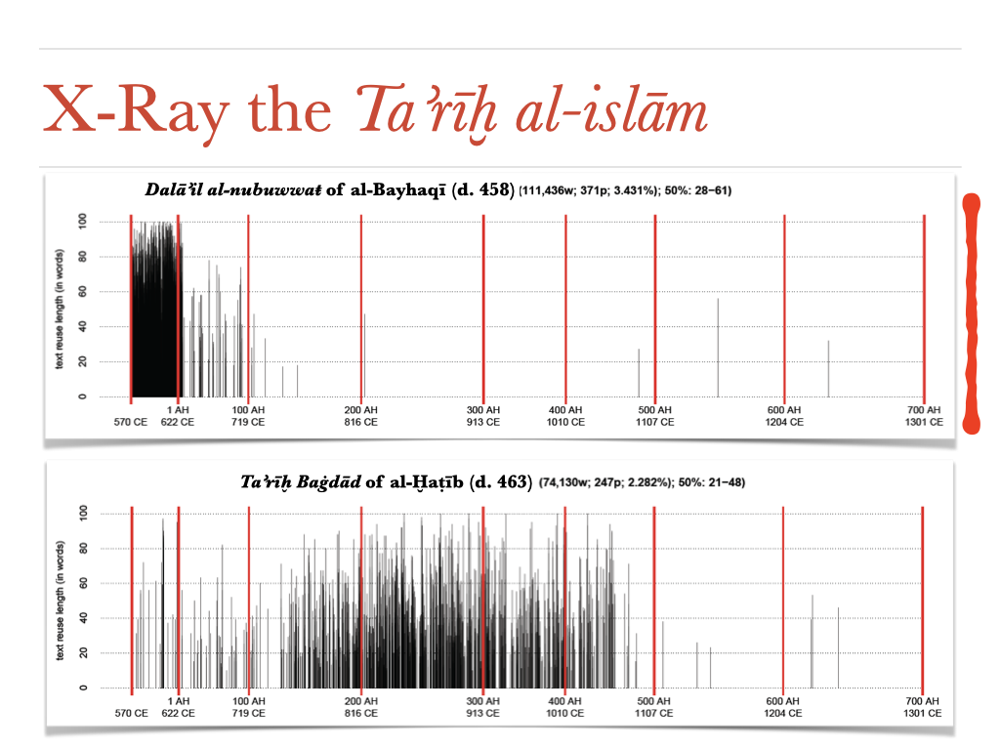

Part 2 · My contributions

--- figure
<!-- reuse 2026-09-28-Cairo:22 -->

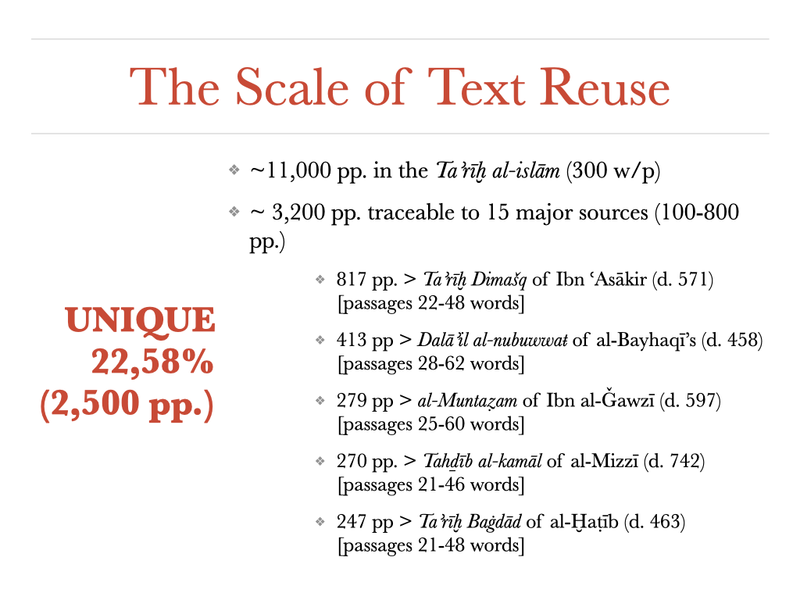

Part 2 · My contributions

--- figure
<!-- reuse 2026-09-28-Cairo:23 -->

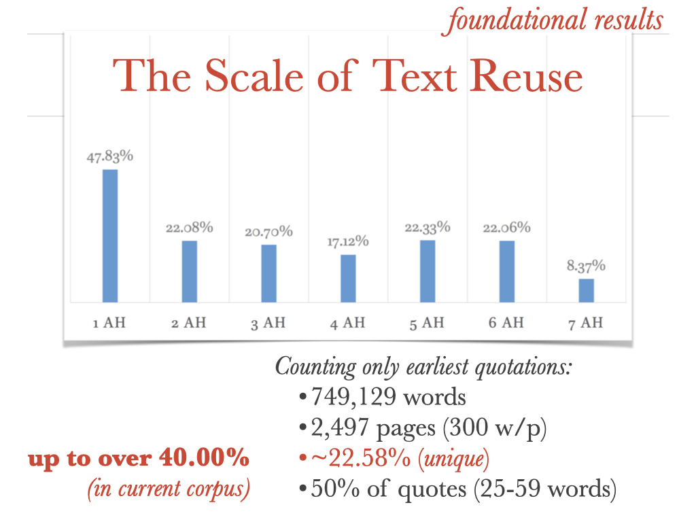

Part 2 · My contributions

--- figure
<!-- reuse 2026-09-28-Cairo:24 -->

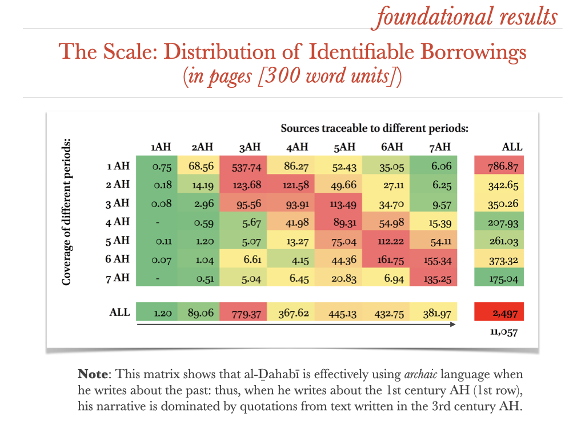

Part 2 · My contributions

--- section light
<!-- reuse 2026-09-28-Cairo:25 -->

Case 2b

# Modeling Textual Typology

By modeling major textual types, we can identify types of unknown books and understand the structural composition of the complex books

Part 2 · My contributions

--- text max=44
<!-- reuse 2026-09-28-Cairo:26 -->
# Case 2b. Modeling Textual Typology

<ol class="small" style="max-width:37em">
<li><code>[B]</code> Biographical type (<em>tarājim</em>): mostly collections of biographies</li>
<li><code>[E]</code> Exegetical type: interpretations of the Qurʾān (<em>tafsīr</em>)</li>
<li><code>[G]</code> Graeco-Arabic (“Greek-esque”) type (<em>yūnāniyyāt</em>): translations from Greek and works on the development of Greek philosophy in Arabic (<em>falsafat</em>, predominantly Aristotelian)</li>
<li><code>[H]</code> Historical type (<em>tawārīḫ</em>): mainly chronicles</li>
<li><code>[F]</code> Legal type (<em>fiqh</em>): a broad variety of legal texts</li>
<li><code>[L]</code> Linguistic type: a broad variety of grammatical, rhetorical, and lexicographical texts (<em>balāġat</em>, <em>naḥw</em>, <em>maʿājim luġawiyyat</em>)</li>
<li><code>[M]</code> Medical type (<em>ṭibb</em>): mainly texts on Galenic medicine</li>
<li><code>[P]</code> Poetic type (<em>šiʿr</em>): mainly collections of poetry (<em>dīwān</em>s)</li>
<li><code>[K]</code> “Scholastic-theological” type: works of <em>kalām</em></li>
<li><code>[Ḥ]</code> Tradition-based type: collections of <em>ḥadīṯ</em></li>
</ol>

Part 2 · My contributions

--- text max=44
<!-- reuse 2026-09-28-Cairo:27 -->

# Testing the model: exegetical type (*tafsīr*)

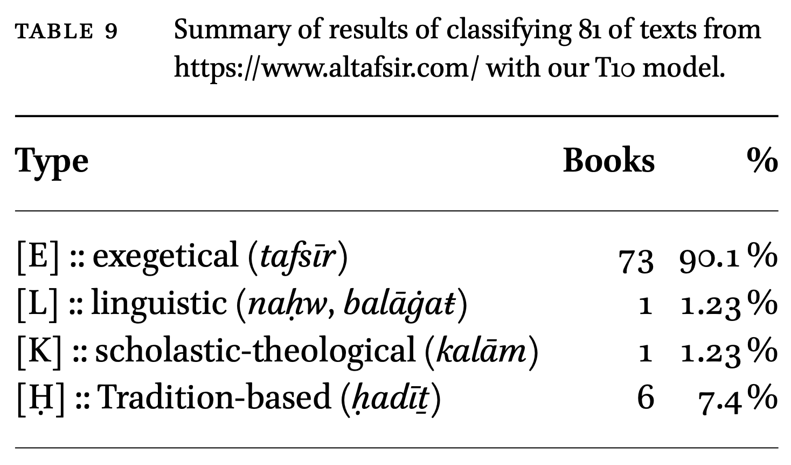

Part 2 · My contributions

--- text max=44
<!-- reuse 2026-09-28-Cairo:28 -->

# The eight exceptions

<ul class="indent small" style="max-width:44em">
<li><em>Mafātīḥ al-ġayb</em> by Faḫr al-dīn al-Rāzī (d. 606/1210) → classified <code>[K]</code> scholastic-theological: it is in fact a major work of <em>kalām</em>, and samples from it were used to train the <code>[K]</code> type</li>
<li><em>Ġarīb al-Qurʾān</em> by Abū Bakr al-Sijistānī (d. 330/942) → classified <code>[L]</code> linguistic (still 26% exegetical signal): closer to a dictionary than to a traditional <em>tafsīr</em></li>
<li>Six early ḥadīṯ-based interpretations — by Mujāhid b. Jabr, ʿAbd al-Razzāq al-Ṣanʿānī, Ibn Ḥakam al-Ḥibarī, al-Nasāʾī, al-Ṭabarī, and Furāt al-Kūfī — classified <code>[Ḥ]</code> Tradition-based: composed mainly of ḥadīṯ reports, so hardly a real mistake; three still carry a strong exegetical signal (28%, 42%, 49%)</li>
</ul>

73 of 81 texts (90.1%) landed correctly on the first pass; every exception is explicable.

Part 2 · My contributions

--- text max=44
<!-- reuse 2026-09-28-Cairo:29 -->

# Rolling Assessment: al-Šāfiʿī’s <i>Kitāb al-Umm</i>

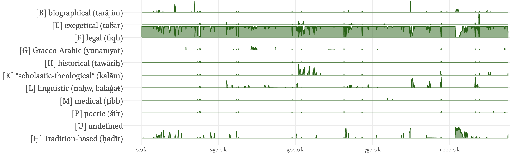

Rolling typological assessment of <i>Kitāb al-Umm</i> of al-Šāfiʿī (d. 204/820) a single dominant type — [F] legal — running almost unbroken from beginning to end.

Part 2 · My contributions

--- text max=44
<!-- reuse 2026-09-28-Cairo:30 -->

# Rolling Assessment: Ibn al-Jawzī’s <i>Talbīs Iblīs</i>

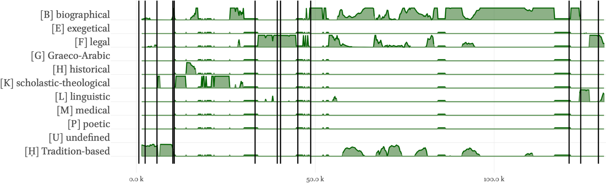

Rolling typological assessment of <i>Talbīs Iblīs</i> of Ibn al-Jawzī (d. 597/1201) shows that individual chapters (separated by vertical black lines) usually contain text reflecting specific types.

Part 2 · My contributions

--- text max=44
<!-- reuse 2026-09-28-Cairo:31 -->
# Majmūʿāt Case

<strong>Value for manuscripts:</strong>

<ol class="indent">
<li>When HTR starts working, we will need a mechanism to assess HTR-ed texts automatically: we can potentially identify type, author, exact text</li>
<li>Particularly valuable for <em>majmūʿāt</em> — the most numerous kind of manuscripts, the most difficult to read and analyze</li>
</ol>

Part 2 · My contributions

--- section light
<!-- reuse 2026-09-28-Cairo:32 -->

Case 3

# A Tradition

language change and topic shifts through chronological layers of books

Part 2 · My contributions

--- split w-60-40 max=44
<!-- reuse 2026-09-28-Cairo:33 -->
# Case 3. Periodization

<ul class="plain" style="color:var(--muted)">
<li>Preclassical &nbsp; c. 622–750</li>
<li>Classical &nbsp; 750–1258</li>
<li>Postclassical &nbsp; 1258–1798</li>
<li>Modern &nbsp; 1798–</li>
</ul>

<b>Preclassical</b>600–750

<b>Classical</b>750–1258

<b>Postclassical</b>1258–1798

<b>Modern</b>1798–

Where do these boundaries come from? What if we ask the corpus?

|||

<em>Geschichte der arabischen Litteratur</em>, 5 vols. (1896–1943)

<em>Cambridge History of Arabic Literature</em>, 6 vols. (1983–2006)

<em>Encyclopedia of Arabic Language and Linguistics</em> (Brill)

Part 2 · My contributions

--- section light
<!-- reuse 2026-09-28-Cairo:34 -->

Two witnesses

# First witness: Corpus

Part 2 · My contributions

--- figure
<!-- reuse 2026-09-28-Cairo:35 -->

Part 2 · My contributions

--- text max=44
<!-- reuse 2026-09-28-Cairo:36 -->
# Two lenses on change

<strong>Keywords</strong> (TF–IDF): <em class="muted">what texts are about</em> 
<strong>Style</strong> (MFV): <em class="muted">how texts are written</em>

<ul>
<li><strong>Hundreds of parameter combinations</strong></li>
<li><strong>3,000 random samples (MFV)</strong></li>
<li><strong>72,000 dendrograms » 48 consensus trees</strong></li>
</ul>

Do not trust a tree. Ask what survives across trees.

<b>Content</b><em>keywords / TF–IDF</em>

<b>Style</b><em>most frequent vocabulary</em>

Part 2 · My contributions

--- split w-25-75 vcenter tight max=44
<!-- reuse 2026-09-28-Cairo:37 -->
# Style

stylometry

<ul class="small" style="font-style:italic">
<li>distributions of frequencies of most frequent words (function words) are unique to individual:</li>
</ul>
<ul class="small" style="font-style:italic;list-style:disc">
<li><strong class="accent">authors</strong></li>
<li>periods</li>
</ul>

|||

Part 2 · My contributions

--- split w-25-75 vcenter tight max=44
<!-- reuse 2026-09-28-Cairo:38 -->
# Style

stylometry

<ul class="small" style="font-style:italic">
<li>distributions of frequencies of most frequent words (function words) are unique to individual:</li>
</ul>
<ul class="small" style="font-style:italic;list-style:disc">
<li>authors</li>
<li><strong class="accent">periods</strong></li>
</ul>

<strong>Jurjī Zaydān’s writings</strong> (1) 1891–1902  (2) 1903–1905  (3) 1906–1914

|||

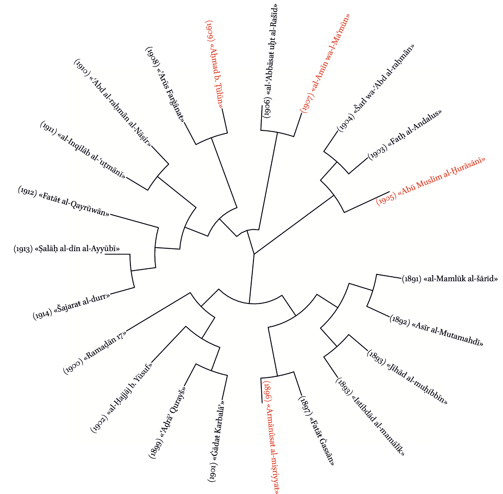

Part 2 · My contributions

--- figure caption="A single dendrogram of 50-lunar-year samples of the corpus, colored by macroperiod. Hijrī dates!"
<!-- reuse 2026-09-28-Cairo:39 -->
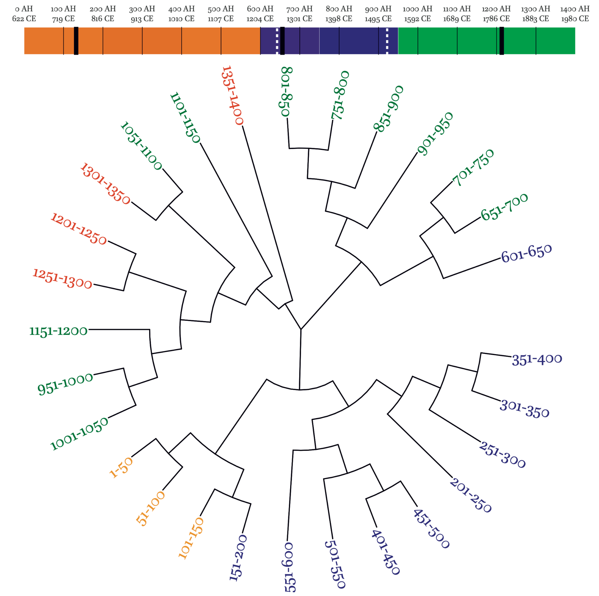

Part 2 · My contributions

--- figure caption="72,000 dendrograms: hundreds of parameter combinations over 3,000 random samples."
<!-- reuse 2026-09-28-Cairo:40 -->

Part 2 · My contributions

--- figure caption="Summary stripe diagrams: what survives across the trees."
<!-- reuse 2026-09-28-Cairo:41 -->

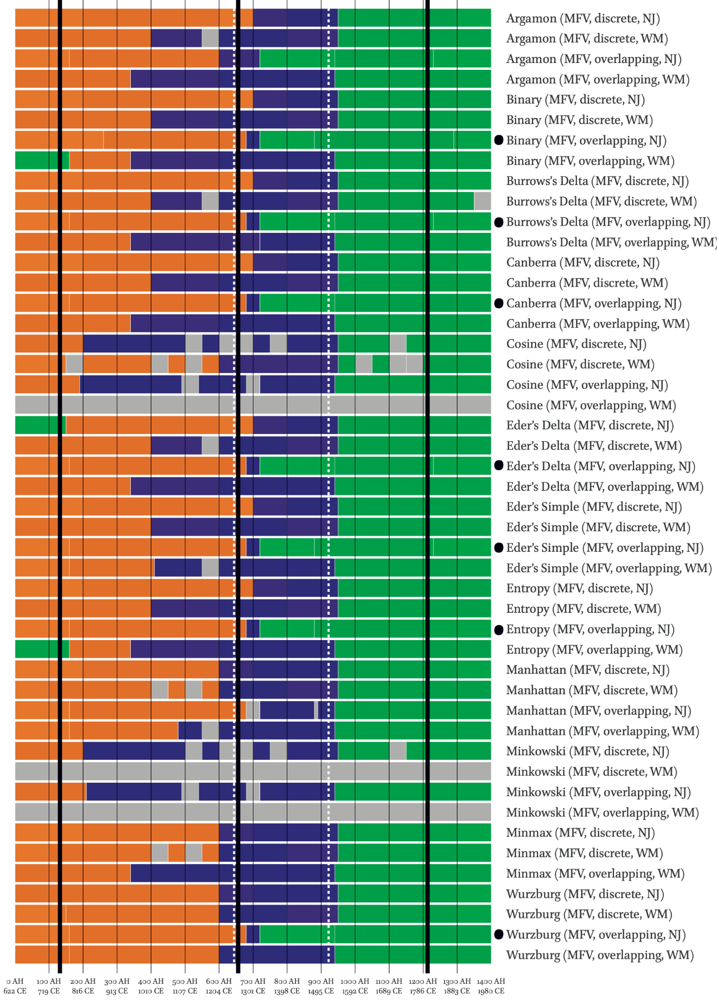

Part 2 · My contributions

--- text max=44
<!-- reuse 2026-09-28-Cairo:42 -->
# Major periods

<ul class="indent">
<li>The early macroperiod (622–1200)</li>
<li>The middle macroperiod (1200–1540)</li>
<li>The late macroperiod (1540–1980)</li>
</ul>

<strong>Results of majority of 72,000 dendrograms:</strong>

3,000 stylometric samples (1,500 discrete; 1,500 overlapping) 12 distance metrics, 2 major clustering algorithms; 48 tf-idf keyword tests.

Part 2 · My contributions

--- text max=44
<!-- reuse 2026-09-28-Cairo:43 -->
# The middle macroperiod (c. 1200–1540)

<ul class="indent">
<li><em>Thematic profiles</em> isolate it as a distinct period</li>
<li><em>Stylometric profiles</em> often attach it to the early macroperiod</li>
<li>The language evolves slower than the written tradition: new distinct themes, but older language</li>
</ul>

Two clocks: themes shift faster than language.

Part 2 · My contributions

--- text max=44
<!-- reuse 2026-09-28-Cairo:44 -->
# A different macrohistory of the written tradition

<ul class="plain indent">
<li>Early: c. 622–1200</li>
<li>Middle: c. 1200–1540</li>
<li>Late: c. 1540–1980</li>
<li>Boundaries are transition zones, not event dates</li>
</ul>

<b>Early</b>c. 622–1200

<b>Middle</b>c. 1200–1540

<b>Late</b>c. 1540–1980

Part 2 · My contributions

--- section light
<!-- reuse 2026-09-28-Cairo:45 -->

Two witnesses

# Second witness:  Bio-Bibliographical Collection

Part 2 · My contributions

--- text max=44
<!-- reuse 2026-09-28-Cairo:46 -->
# Second witness: 8,800 authors

Ismāʿīl Bāšā al-Baġdādī (d. 1338/1919)

<em>Hadiyyat al-ʿārifīn</em> <em>c. 8,800 authors; 40,000+ titles</em> A bio-bibliographical model of the tradition

<strong>Independent of the corpus experiments</strong>

<b>8,800</b>authors

<b>40,000+</b>titles

Part 2 · My contributions

--- text max=44
<!-- reuse 2026-09-28-Cairo:47 -->
# c. 600–1200: an Iraqi-Iranian world
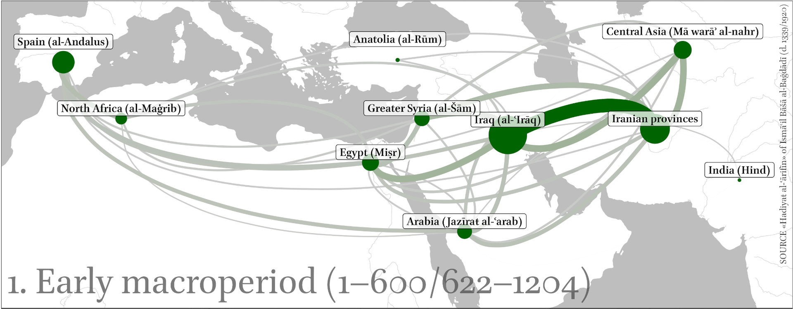

<b style="font-size:36px">&gt; 80% Iraq + Iran</b>

Part 2 · My contributions

--- text max=44
<!-- reuse 2026-09-28-Cairo:48 -->
# c. 1200–1540: a Syrian-Egyptian world

<b style="font-size:36px">&gt; 55% Egypt + Syria</b>

Part 2 · My contributions

--- text max=44
<!-- reuse 2026-09-28-Cairo:49 -->
# c. 1540–1900: a new polycentric geography
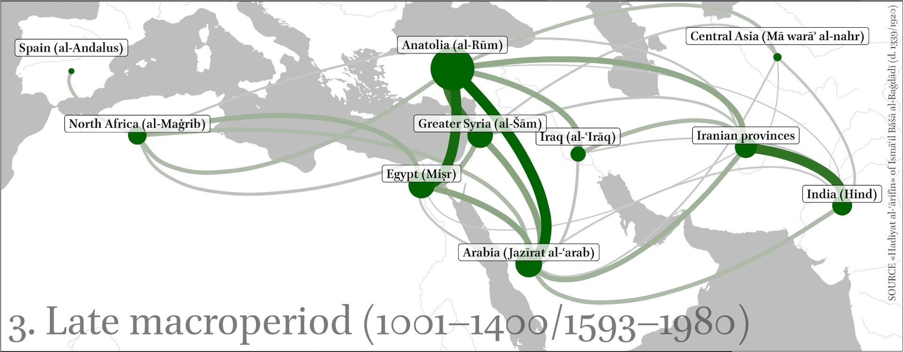

<b style="font-size:36px">≈ 30%  Anatolia</b>

Part 2 · My contributions

--- text max=44
<!-- reuse 2026-09-28-Cairo:50 -->
# Two transitions: <strong>1200–1300</strong> and 1500–1600
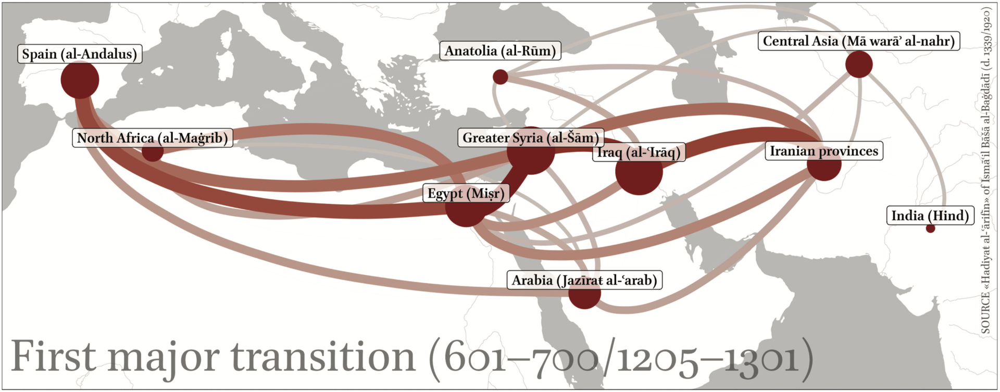

Part 2 · My contributions

--- text max=44
<!-- reuse 2026-09-28-Cairo:51 -->
# Two transitions: 1200–1300 and <strong>1500–1600</strong>

Part 2 · My contributions

--- text max=44
<!-- reuse 2026-09-28-Cairo:52 -->
# Two independent witnesses

<strong>CORPUS of TEXTS</strong> lexical/thematic and stylometric change

<strong>REGISTER of AUTHORS</strong> cultural geography over time

Different biases. Different assumptions.  Similar macro-boundaries.

Part 2 · My contributions

--- text max=44
<!-- reuse 2026-09-28-Cairo:53 -->
# Three long cultural regimes (macroperiods)

<ol class="indent">
<li>The early Iraqi-Iranian &nbsp;·&nbsp; <em>c. 622–1200</em></li>
<li>The middle Syrian-Egyptian &nbsp;·&nbsp; <em>c. 1200–1540</em></li>
<li>The late Turco-Indian &nbsp;·&nbsp; <em>c. 1540–1980</em></li>
</ol>

(with discernable sub-periods inside each)

Part 2 · My contributions

--- text max=44
<!-- reuse 2026-09-28-Cairo:54 -->
# Periods are also places

<ul class="indent">
<li><strong>Traditional periodization</strong> assumes universality</li>
<li><strong>Corpus-driven, computational periodization</strong> demonstrates that <em>language and textual production are aligned in time with changing cultural geography</em></li>
</ul>

Each period gets not just a name, but also a map.

Part 2 · My contributions

--- text max=44
<!-- reuse 2026-09-28-Cairo:55 -->
# What changes if we accept this model?

<ul class="indent">
<li>The Mamluk centuries become a coherent middle period, <em>not the beginning of decline</em></li>

<li><strong>c. 1540</strong> emerges as a major structural break (essentially, the end of the Mamluk period); not 1258, the fall of Baġdād and of the ʿAbbāsids</li>

<li>Chronology <i>&amp;</i> geography become part of the same explanation</li>
</ul>

Part 2 · My contributions

--- text max=44
# Quantitative evidence and interpretive analysis

Close reading supplies questions and historical context.

Corpus comparison establishes patterns and their reach.

Those patterns direct attention to particular passages.

Reading the passages refines the next comparison.

Part 2 · My contributions

Notes:
Outline 2.G: The heuristic loop between close and distant reading. Planned time: 50 seconds.

Interpretation is involved throughout, from evidence construction to explanation. Avoid a rigid division between quantitative discovery and qualitative interpretation. This connects all three case studies and prepares the shift to biographical evidence.

--- text max=44
# EIS1600: biographies linked across collections

<b>604,000</b>biographical records

<b>≈140,000</b>identified individuals

<b>285</b>biographical collections

- Approximately **104,000 individuals with explicit dates**
- Compare recorded lives across collections, regions, and periods

EIS1600 team · current project figures, November 2026

Part 2 · My contributions

Notes:
Outline 2.H: EIS1600: from biographical evidence to historical research. Planned time: 75 seconds.

Distinguish records from linked individuals. Around 340,000 records with chronological or geographical evidence form the usable merged subset; do not suggest all 604,000 records independently resolve to 140,000 people. Approximately 80,000 dated individuals concern the first millennium of Islamic history in the agreed outline. Credit the project team. The comparison with PUA is one of scope, not scholarly quality.

--- text max=44
# Three volumes establish the research foundation

**Methodological Companion**
Extraction, annotation, reconciliation, and analysis

**Historical Atlas of Social Groups**
Groups and affiliations across time and space

**Analytical Reference on Biographical Collections**
Coverage, composition, and relationships among sources

Target: complete drafts by the end of EIS1600 in mid-2027.

Part 2 · My contributions

Notes:
Outline 2.H: EIS1600: from biographical evidence to historical research. Planned time: 70 seconds.

This is a drafting target, not a promise of publication by the project’s end. The atlas asks, for example, how the geography of the Mālikī school differs from the Šāfiʿī. The analytical reference compares collections such as Ibn al-Faraḍī’s Tārīḫ ʿulamāʾ al-Andalus and al-Ḫaṭīb al-Baġdādī’s Tārīḫ Baġdād. The two interpretive syntheses follow as a continuing agenda at the Escuela and will receive their own slides in Part 4. Source: Maxim’s update of November 16, 2026.

--- text max=44
# A related study of monetary equivalents

**68,000 monetary equivalents in historical sources**

- Who paid whom, for what, and how much?
- Where and when did the transaction occur?
- Approximately 80% can be situated in time and space.

EIS1600 doctoral research · Hamid Reza Hakimi

Part 2 · My contributions

Notes:
Outline 2.H: EIS1600: from biographical evidence to historical research. Planned time: 40 seconds.

Keep the contribution distinct from the five-volume program. Credit the dissertation researcher and team. The quantity and locatability figure come from the agreed detailed outline. This example demonstrates that the methods support a researcher’s independent historical question.

--- text max=44
# A foundation for sustained research

**Words · books · people · the written tradition**

- Comparable evidence across different scales
- Methods that lead back to identifiable sources
- Instruments through which others can pursue their own questions

The next stage connects these investigations and expands their evidence.

Part 2 · My contributions

Notes:
Outline 2.I: What these contributions establish together. Planned time: 40 seconds.

Close Part 2 with the shared achievement rather than another inventory. The methodological ambition extends from morphological forms to the whole tradition, but detailed linguistic annotation belongs to the proposed next stage.

--- section light partdiv
<!-- divider · Part 3 -->

Part

3

# Future development

Where the field can go next

Notes:
Part 3: Future development.

--- text max=44
# Toward a connected history of the tradition

**Texts · bibliographies · biographies · manuscripts**

How did writing develop through relationships among textual types, scholarly communities, places, and historical periods?

Large-scale comparisons remain connected to individual sources.

Part 3 · Future development

Notes:
Outline 3.A: The next step: connecting the evidence across scales. Planned time: 45 seconds.

Part 3 describes scientific directions. Part 4 specifies what I can begin and sustain at the Escuela. These forms of evidence offer different views; connecting them does not erase their different biases.

--- text max=44
# ArabesQuery: the historical organization of writing

- How do textual types emerge and differentiate?
- How do authors combine them within individual works?
- How do those relationships change across periods and regions?

Reconstruct how Arabic authors organized and reorganized written knowledge.

Part 3 · Future development

Notes:
Outline 3.B: ArabesQuery: reconstructing the tradition through its textual types. Planned time: 60 seconds.

Develop the classifier examples into a research agenda. Conventional generic and disciplinary labels remain historical evidence. The analysis investigates how they relate to the internal composition of works. ArabesQuery is the typological strand of the continuing program; social history and historiography remain its primary historical line. Funding affects scale and team organization, discussed in Part 4.

--- split max=44
# Two complementary views of the tradition

**Corpus-through-corpus**

Compare surviving texts, their internal structures, and recurring profiles.

|||

**Bibliography-through-bibliography**

Compare how bibliographers describe works, authors, subjects, and their relationships.

Part 3 · Future development

Notes:
Outline 3.C: Two complementary approaches: corpus-through-corpus and bibliography-through-bibliography. Planned time: 70 seconds.

Examples: Ibn al-Nadīm’s Fihrist, Kašf al-ẓunūn, Hadiyyaŧ al-ʿārifīn, and later GAL, GAS, and ALA. Compare textual profiles with historical classifications. Works known only bibliographically matter too. Convergence and disagreement generate research questions and reveal limits of digital coverage. Source: ArabesQuery proposal and outline 3.C.

--- text max=44
# Writing in its social and geographical settings

- Link authors and works to biographical attestations.
- Compare textual developments with scholarly communities and mobility.
- Trace where forms of writing became concentrated and how that changed.

EIS1600’s data support the “mapping tradition” dimension of ArabesQuery.

Part 3 · Future development

Notes:
Outline 3.D: Connecting texts to people, places, and historical circumstances. Planned time: 50 seconds.

Biographical evidence has an independent historical purpose and also supplies context for typology. Distinguish an author’s geographical associations from a demonstrated place of composition for a particular book. Extend coverage for later centuries where the existing project is thinner. Preparing these links can proceed alongside the syntheses.

--- text max=44
# Expanding the printed corpus

**≈50,000 digitized volumes / PDFs**

**≈25,000 distinct works**, subject to bibliographical reconciliation

- Identify works, editions, and volumes.
- Recover text and structure, with links to the page images.
- Prioritize gaps that matter for specific research questions.

Part 3 · Future development

Notes:
Outline 3.E: Expanding the printed corpus. Planned time: 45 seconds.

These are working estimates for an expansion opportunity, not counts of completed transcriptions or a commitment to process everything immediately at EEA. Distinguish PDFs, volumes, works, and editions. A broader corpus lets us test dependence on current coverage. Begin with manageable, question-driven selections using the existing workflow.

--- text max=44
# Comparing OCR outputs improves the evidence

**Adapt the logic of double-keying to automated recognition**

1. Produce multiple transcriptions of the same pages.
2. Align the readings and identify disagreements.
3. Check uncertain passages against the images.
4. Preserve corrections and textual structure for review.

Part 3 · Future development

Notes:
Outline 3.F: Improving textual evidence through multiple OCR outputs. Planned time: 50 seconds.

The principal components of this workflow are already operational. Conventional OCR and vision-language models can supply complementary readings. Agreement is evidence, not a guarantee of correctness: systems may share errors. Recover headings, paragraphs, poetry, and notes where possible. Avoid promising a fixed corpus-wide error rate.

--- text max=44
# Manuscripts extend the evidence

- Multiple witnesses and substantial textual variation
- Composite volumes and multi-text manuscripts
- Uncertain attribution and incomplete cataloging

**A work and its material witnesses remain connected.**

Selective studies can begin now; large-scale expansion is a collaborative ambition.

Part 3 · Future development

Notes:
Outline 3.G: Extending from printed books to manuscripts. Planned time: 45 seconds.

Introduce HTR and related recognition methods as means of investigating manuscript evidence. The proposed Akademie collaboration offers a possible route to large-scale expansion, not secured funding or an EEA resource. Do not make the core program depend on this proposal. The printed-PDF estimate on the previous slide is not a manuscript count.

--- text max=44
# From production to transmission and reception

- Where and for how long did a work circulate?
- Which communities copied, owned, read, or taught it?
- Which texts were assembled or adapted together?

Composition, copying, and later use are different historical events.

Part 3 · Future development

Notes:
Outline 3.H: From book production to transmission and reception. Planned time: 50 seconds.

Connect text reuse with material evidence of copying, ownership, annotation, teaching, and reading. These sources help distinguish initial production from subsequent circulation. Relate this work to KITAB and to manuscript collaborations without claiming that all evidence is already integrated.

--- text max=44
# Language evolution at several levels

How did Arabic change across the written tradition?

- **Morphology:** forms and their distribution
- **Syntax:** constructions and patterns of combination
- **Lexicon:** vocabulary, meanings, and contexts of use

Richer textual annotation can extend the analyses begun in the book.

Part 3 · Future development

Notes:
Outline 3.I: The next generation of philological instruments. Planned time: 70 seconds.

Lead with the research question. The book could not supply this detailed morphological, syntactic, and lexicological history. As NLP methods improve, progressively annotate texts and compare linguistic features across time. Begin with selected features and validated subsets rather than claiming uniform annotation quality for every work. This is a research direction whose scope can grow with improved methods. Source: Maxim’s November 16 update.

--- text max=44
# Classical Arabics?

**Did Classical Arabic in the West differ from Classical Arabic in the East?**

- Compare regional usage within comparable periods and textual types.
- Trace whether differences persisted, shifted, or converged.
- Relate linguistic patterns to intellectual and social contexts.

Part 3 · Future development

Notes:
Outline 3.I: The next generation of philological instruments. Planned time: 70 seconds.

Present “Classical Arabics” as a question, not a predetermined finding. More extensive coverage and the annotations just described make the comparison possible. Distinguish regional differences from differences in period, genre, author, source coverage, and textual transmission. The West/East contrast is a starting question, not a fixed binary geography.

--- text max=44
# Instruments for rapid hypothesis checks

Extend **NgramReader** with morphological, lexical, and syntactic information.

Compare a feature across **time, space, and textual type**.

Return immediately to the passages behind the pattern.

Part 3 · Future development

Notes:
Outline 3.I: The next generation of philological instruments. Planned time: 40 seconds.

Tools serve the preceding questions. Richer annotations can make hypotheses more precise and quicker to check. Connect with Book Classifier, biographical metadata, bibliography, and text-reuse evidence when they help the question. Label these as proposed extensions, not functions already demonstrated.

--- text max=44
# A disciplinary program that can accumulate

Broader evidence makes new questions possible.

Explicit methods make findings comparable.

Sustained interpretation turns comparisons into historical arguments.

The Escuela can provide continuity for this work.

Part 3 · Future development

Notes:
Outline 3.J: The larger disciplinary opportunity. Planned time: 30 seconds.

Transition to implementation. The agenda is larger than a single grant. Explain next how existing evidence and personal research make an initial program feasible, and how collaborations and funding can extend it.

--- section light partdiv
<!-- divider · Part 4 -->

Part

4

# My research program at Granada

A program for the Escuela de Estudios Árabes

Notes:
Part 4: My research program at Granada.

--- text max=44
# A continuing historical program at the Escuela

**Social history and historiography through biographical collections**

- Complete the historical and historiographical syntheses.
- Build on the three foundational volumes drafted during EIS1600.
- Develop focused ArabesQuery studies and prepare the links for mapping the tradition.

Part 4 · My research program at Granada

Notes:
Outline 4.A: A coherent research agenda with an existing foundation. Planned time: 50 seconds.

Make the continuity explicit. The first three volumes have a drafting target of the project’s end in mid-2027. The two syntheses require further interpretation and are natural work to complete at the Escuela. Historiography was not an original EIS1600 objective; it emerged through investigating how the sources select and transform evidence. Do not characterize it as an overdue original deliverable. Additional funding is not needed to begin these syntheses.

--- text max=44
# Four continuing research lines

1. **Social history, historiography, and biographical collections**
2. **Typology of the Arabic written tradition**
3. **Transmission, reuse, and intellectual networks**
4. **Language change in context**

The research lines of the submitted VISIÓN

Part 4 · My research program at Granada

Notes:
Outline 4.B: The central research objectives. Planned time: 40 seconds.

Use the headings and order from VISIÓN. The first line remains the primary continuing research line. These lines connect but have distinct questions and outputs. The next two slides make the historical work concrete; Parts 2 and 3 have already explained the others.

--- text max=44
# Historiographical synthesis: how the sources shape the past

- How do biographers select, omit, abbreviate, and expand earlier accounts?
- How do those choices alter the representation of people and communities?
- Which patterns reflect shared sources or changing historiographical priorities?

A new research direction emerging from EIS1600’s evidence.

Part 4 · My research program at Granada

Notes:
Outline 4.B: The central research objectives. Planned time: 75 seconds.

This synthesis has a comparatively concrete analytical structure: link accounts of the same person, compare their text and coverage, identify transformations, and interpret recurring editorial choices. The “Golden Sample” provides a starting demonstration through more than 2,000 biographies al-Ḏahabī borrowed from Andalusian authors. Existing data and methods make focused studies possible now. Historiography was not part of the original project design, so present it clearly as a natural evolution of the agenda to complete at the Escuela. Relate differences to compilers’ purposes rather than reducing source criticism to an error correction exercise.

--- text max=44
# Historical synthesis: interpreting social transformation

**Did scholarly life change, or did its historians’ vantage point change?**

- Compare social groups, geographical distributions, and mobility across collections.
- Test whether different sources support the same historical interpretation.
- Connect regional studies into a broader account of Islamic societies.

Part 4 · My research program at Granada

Notes:
Outline 4.B: The central research objectives. Planned time: 80 seconds.

The answer to the opening question can involve both. This synthesis is more difficult because many processes interact: social groups, institutions, migration, textual survival, and compilers’ choices. Build it through bounded comparative studies, source-by-source checks, and the atlas/reference volumes before advancing a larger interpretation. The goal is a synthetic history grounded in biographical evidence, with the limits of that evidence visible. Avoid treating recorded biographies as a census of society. No fixed completion date is asserted.

--- text max=44
# A Digital Arabic Philology Laboratory

**Research** develops historical and philological arguments.

**Instruments** make methods and evidence reusable.

**Training** takes place through apprenticeship, workshops, and summer schools.

Research questions guide how the laboratory develops.

Part 4 · My research program at Granada

Notes:
Outline 4.C: The laboratory’s organizing principle. Planned time: 45 seconds.

Present the laboratory as an organizing principle for the program, not an already authorized administrative unit or a request for an unfunded infrastructure commitment. It can begin through my research, documented instruments, focused collaborations, and feasible training activities.

--- text max=44
# A methodological collaborator within the Escuela

- Begin with colleagues’ questions and source expertise.
- Develop comparisons together and return to the underlying texts.
- Connect al-Andalus and the Maghrib with the wider Arabic tradition.

**Joint publications, datasets, supervision, and proposals**

Part 4 · My research program at Granada

Notes:
Outline 4.D: A methodological collaborator within the Escuela. Planned time: 45 seconds.

Existing Spanish connections, including the PUA context, provide a foundation. Explain reciprocal collaboration: colleagues’ source expertise challenges and improves the methods; comparative analysis can enlarge the reach of their questions. Do not promise named colleagues’ participation without an agreed project.

--- text max=44
# Research outputs that others can use

- Historical and philological studies
- Curated corpora and documented datasets
- Methods, models, and research applications
- Teaching materials grounded in completed studies

Part 4 · My research program at Granada

Notes:
Outline 4.E: Research instruments as identifiable deliverables. Planned time: 35 seconds.

NgramReader and Book Classifier demonstrate what is already possible. Improvements should follow specific research needs: geographical analysis, passages, contextual comparison, and links to biographies and bibliography. Preserve evidence and methods so others can use them even as interfaces change.

--- text max=44
# An established network for collaborative research

**Corpus and computational research:** OpenITI, KITAB, and methodological collaborators

**Philology, manuscripts, and history:** existing German and Spanish collaborations

**Training and exchange:** Europe, the Middle East, North America, and Japan

Part 4 · My research program at Granada

Notes:
Outline 4.F: An established international research network. Planned time: 45 seconds.

Use selected names orally rather than a long list on the slide. OpenITI/KITAB: Sarah Bowen Savant, Matthew Thomas Miller, David Smith. Methods: Tara Andrews, Maciej Eder. Philology/history: Beatrice Gründler, Jens Scheiner, Konrad Hirschler. Spain: Maribel Fierro, Mayte Penelas. Japanese colleagues’ forthcoming Hamburg workshop illustrates ongoing exchange. Existing relationships are distinct from funded commitments to the proposed laboratory.

--- text max=44
# Training through research apprenticeship

Participants develop a question with their own sources.

They prepare the evidence, apply a method, and test the interpretation.

**Each researcher produces an identifiable scholarly contribution.**

Part 4 · My research program at Granada

Notes:
Outline 4.G: Training through an apprenticeship model. Planned time: 45 seconds.

Explain the full sequence: question, source assessment, curation, methodological assumptions, analysis, checking against the sources, and a documented argument. A contribution could become an article, dataset, methodological study, or dissertation component. The objective is growing independence alongside contribution to shared research.

--- text max=44
# Workshops and summer schools

- Select participants around substantive research questions.
- Work with their own sources and projects.
- Combine guided analysis with follow-up mentoring.

**Previous activities:** Tokyo · Granada · Hamburg · Bern · Madrid

Part 4 · My research program at Granada

Notes:
Outline 4.H: Workshops and summer schools as an international training program. Planned time: 45 seconds.

Give one or two examples rather than reading the whole record: Tokyo 2023, computational Andalusian prosopography at EEA 2024, Hamburg and Bern 2025, and the CSIC AI workshop in Madrid 2026. A further Hamburg workshop with Japanese colleagues is forthcoming. Start with manageable activities; larger international summer schools and travel support depend on practical resources and funding.

--- text max=44
# My research and a potential ArabesQuery team

**With existing resources**
My syntheses, focused typological studies, and preparation of biographical links

**If ERC funding is awarded**
The team carries out most ArabesQuery work, with my scientific direction, while I complete the syntheses and connect their data to the project

Part 4 · My research program at Granada

Notes:
Outline 4.I: Building a team and sustaining collaboration. Planned time: 40 seconds.

State the conditional clearly. No team is assumed to exist. In the funded scenario, organize complementary responsibilities so the syntheses and ArabesQuery advance together. The PI retains scientific leadership and integration. Without the grant, continue a bounded program through existing corpora, methods, instruments, and focused collaboration.

--- text max=44
# Leadership and external funding

- EIS1600: research coordination, supervision, and shared outputs
- Service on **three ERC Consolidator panels**
- Spanish and international funding to expand the program

Funding increases the scale and pace of work built on an existing foundation.

Part 4 · My research program at Granada

Notes:
Outline 4.J: Funding, research leadership, and institutional contribution. Planned time: 40 seconds.

Mention grant-development experience as a contribution to colleagues and the Escuela. Do not imply influence over future ERC decisions or discuss confidential panel material. Describe the current ERC outcome as conditional; pursue further applications as appropriate rather than presupposing rejection and a resubmission.

--- text max=44
# What I can begin with existing resources

| Existing basis | Initial research and outputs |
|---|---|
| Linked biographies and established methods | Comparative studies for both syntheses |
| OpenITI and typological models | Focused studies of textual types |
| Biographical and geographical evidence | Author–work links for mapping the tradition |
| Working instruments and training experience | Documented applications and focused collaboration |

Large-scale corpus expansion, recruitment, and manuscript integration can grow with additional resources.

Part 4 · My research program at Granada

Notes:
Outline 4.K: A phased and feasible program. Planned time: 85 seconds.

Respond directly to the feasibility criterion. The core work uses corpora, methods, applications, and research experience already developed, together with the normal research environment at EEA. Do not claim unconfirmed dedicated staff, a computing cluster, or a specific budget from EEA. The initial outputs are concrete comparative studies and progress toward the syntheses. Funding enables scale; it is not the precondition for the research aims. Rehearsal checkpoint: leave time for the final proposition.

--- text max=44
# The proposition for Granada

**A Digital Arabic Philology Laboratory**

Sustained historical and philological research

Reusable evidence, methods, and instruments

Training through active research and international exchange

Part 4 · My research program at Granada

Notes:
Outline 4.L: The proposition for Granada. Planned time: 30 seconds.

Close with the scholarly contribution to the Escuela: a continuing program rooted in social history and historiography, connected to the wider Arabic written tradition through typology, transmission, and language. The institutional proposition brings research, instruments, and training together. Stop here; no additional thank-you or recap slide is necessary.
